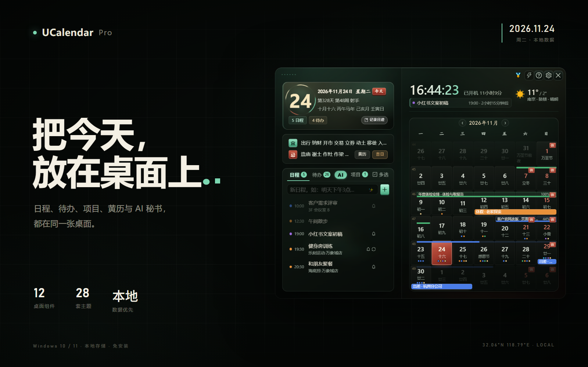
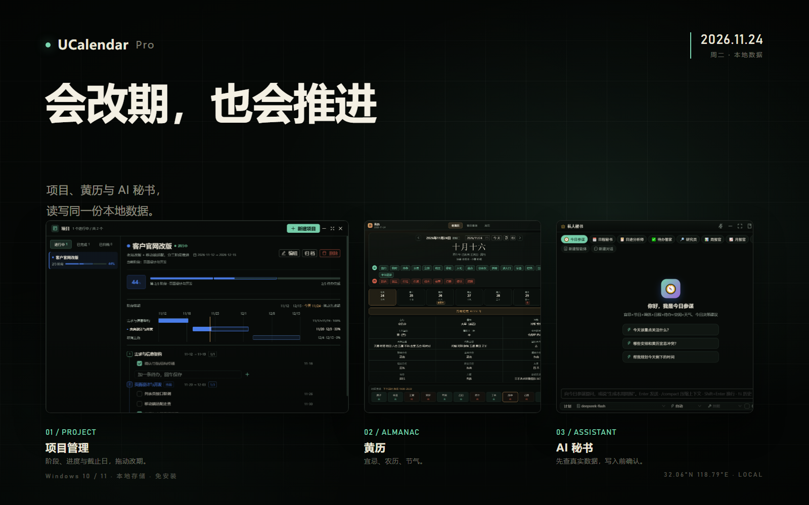
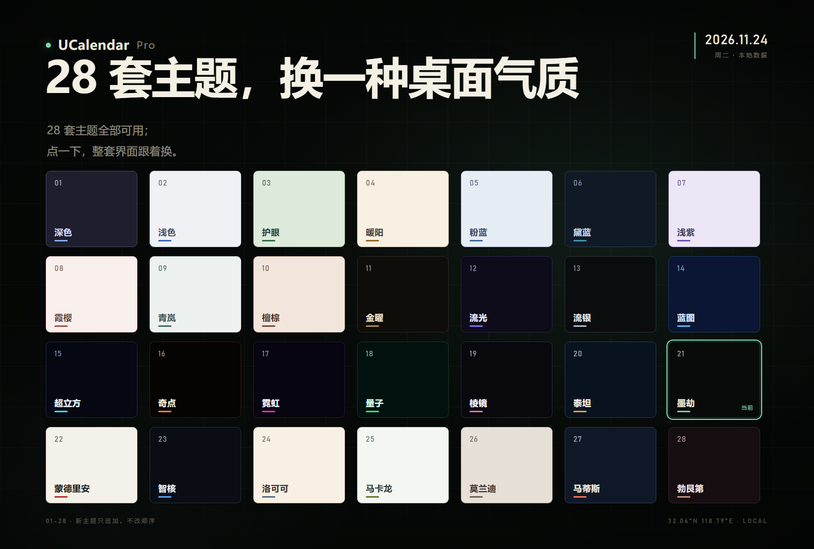

<p align="center">
  <a href="https://tobaba.github.io/ucalendar-site/">SITE</a>
  &nbsp;·&nbsp;
  <a href="https://github.com/tobaba/UCalendar/releases/latest">DOWNLOAD</a>
  &nbsp;·&nbsp;
  <a href="https://github.com/tobaba/UCalendar/releases">RELEASES</a>
  &nbsp;·&nbsp;
  <a href="https://github.com/tobaba/UCalendar/issues">ISSUES</a>
  &nbsp;·&nbsp;
  <a href="#怎么支持">SUPPORT</a>
</p>

<p align="center">
  
</p>

<h1 align="center">UCalendar Pro</h1>

<p align="center">
  <b>Windows 桌面日历 + AI 私人秘书。</b><br>
  任务栏时钟、日程、待办、项目、黄历、12 个桌面组件和 AI 秘书，收在同一张桌面。<br>
  本地存储，不登录，不订阅，单文件约 9.9 MB。
</p>

## 一眼看懂

- **任务栏时钟即入口**：左键呼出面板，右键是快捷菜单；`Ctrl+Alt+C` 全局热键，托盘常驻
- **12 个桌面组件**：月历、今日安排、天气、番茄钟、便签、倒计时、世界时钟、秒表、时间进度、项目进度、股票行情、音乐播放
- **会动手的 AI**：一句话建日程、查空、改期、写周报；先查真实数据，写入前确认
- **项目不是一条待办**：阶段、进度、时间轴拖拽改期，月历项目条直达
- **黄历 / 吉日**：1900–2100 离线宜忌、时辰吉凶、吉日筛选，找到日子直接加日程
- **完整 Pro 能力**：28 套主题、项目管理、便签管理、日迹、时间册导出、今日节奏、工作区预设、微信机器人、股票与音乐，全部在同一个版本里
- **本地优先**：数据默认在 `%LOCALAPPDATA%\UCalendar`；exe 同目录有 `data\` 时自动用便携目录

## 12 个桌面组件，读同一份数据

<p align="center">
  
</p>

**不是静态展示卡。** 主面板改完，桌面上的组件立刻同步；组件收起后汇总到全局胶囊栏，点击或悬停展开。

- **月历**：农历、节气、节假日调休、跨天日程条、项目条与日程圆点
- **今日安排**：逾期 / 今天 / 本周 / 本月 / 全年五档视图，日程与待办按时间排好
- **天气**：实时天气、24 小时逐时、7 天预报、日出日落与空气质量
- **番茄钟**：专注 / 短休 / 长休周期可调，结束自动播报
- **便签**：彩色便签常驻桌面，随手记，随时看
- **倒计时**：生日、纪念日、假期与考试，重要日子一眼可见
- **世界时钟**：本地时间、农历，再加伦敦、纽约、东京等时区
- **秒表**：分段计时，最快最慢自动标出
- **时间进度**：今天、本周、本月、今年，看看时间走到了哪里
- **项目进度**：进行中项目按截止日排好，进度环、当前阶段和剩余天数一眼看到
- **股票行情**：自选最多 20 只，实时行情与 K 线，多源自动回退
- **音乐播放**：接管 Windows 系统媒体会话，封面、歌名、进度、播放控制与 6 种系统混音频谱

全部组件支持拖动、缩放、透明度、锁定、鼠标穿透和位置记忆；Pro 还支持磨砂、字体、字号、前景色，一次应用到全部。

## 不只日历，是一张工作台

<p align="center">
  
</p>

### 项目管理（Pro）

**项目不是一条待办，是一段有阶段的推进。** 客户改需求、阶段延期、待办散落——项目页把阶段、进度和提醒放在同一条时间轴上。

- **阶段进度**：完成率 = 阶段位置 + 当前阶段待办完成度；没有待办时也不会算假进度
- **时间轴拖拽**：直接拖动阶段起止改期，不用翻表单
- **项目条直达**：月历上的项目条显示当前阶段和进度，点一下打开并聚焦该项目
- **阶段提醒**：前 1 天 / 当天 09:00 提醒，节点不漏
- **归属清晰**：日程按时间轴独立安排；待办能挂到项目和阶段

### 黄历 / 吉日

**择日不靠翻网页，宜忌不靠猜。** 内置 1900–2100 黄历数据，独立窗查老黄历和吉日；找到日子直接落到日程或项目阶段。

- **离线黄历**：宜忌、18 格信息、时辰吉凶、下个吉时、未来 7 天
- **吉日筛选**：范围 / 仅周末 / 30–180 天，结果按月份分组
- **直接落地**：一键加日程，或写进项目阶段
- **分享长图**：把宜忌和吉日清单带走

### 便签、日迹与今日节奏（Pro）

- **便签管理页**：彩色便签、标签、星标、搜索、归档，桌面便签与快速记录共用一份数据
- **日迹**：每天留一段记录，AI 日迹分析师帮你复盘，从日程和文字里找模式
- **今日节奏**：按精力与空闲时间排出今天先做什么，不只是一张待办清单
- **时间册导出**：按日 / 周 / 月 / 年导出时间记录，Markdown 与长图都能带走
- **工作区预设**：不同项目、不同场景一键切换，AI 和工作区文件各有自己的上下文

## AI 私人秘书，真的会动手

<p align="center">
  
</p>

```text
你：明天下午三点开会，提前 15 分钟提醒我
AI：已创建「开会」15:00（提醒 14:45），要现在写入吗？
你：好
AI：已写入日历
```

- **一句话建日程**：「明天下午三点开会 在会议室 A」「每周一晨会」——时间、地点、重复、提醒一次识别
- **会查也会改**：问「这周还有哪些空？」「把周四的健身改到晚上 8 点」，查真实数据再动手
- **日报 / 周报 / 月报 / 年报**：按真实日程与待办生成 Markdown
- **8 个预设助手**：今日参谋、日程秘书、日迹分析师、待办管家、研究员、周报官、月报官、年报官
- **自定义智能体**：一句话描述需求，AI 生成提示词、图标、名称和简介，保存后直接出现在列表
- **技能与记忆**：工作区 `skills/` 放技能说明，输入 `/` 直接选择并注入；支持跨会话记忆和检查点
- **多服务商**：DeepSeek、任意 OpenAI 兼容接口、Claude；Key 自己填，只存本机
- **安全边界**：写日程、删数据、执行命令都要确认；文件操作限定在工作目录

### 微信机器人（Pro）

UCalendar 运行时扫码绑定微信，私聊即可查询和修改日程、待办、便签，发图片还能交给 AI 识别。陌生微信先发 `/pair 配对码` 才能用；token 只存本机，关闭 UCalendar 即停止服务。

常用指令：`/today` `/weather` `/almanac` `/news` `/new` `/stop` `/support`

## 任务栏时钟，是入口也是门面（Pro）

- **Win11**：常驻 TAP 渲染器，切换格式、字体、字号、颜色和天气只更新 `clock.json`，不再每次重建窗口或重复注入 DLL
- **Win10**：native clock host，宽样式向左扩展时同步重排任务栏左侧内容；切换小任务栏按钮后自动重注入
- **副屏**：支持主任务栏与 `Shell_SecondaryTrayWnd`，菜单锚点按点击位置选择最近的任务栏矩形
- **自定义格式**：一行默认 `hh:ff:ss 星期W JJ`，支持多行、字号同/异、点选或拖入变量
- **天气**：任务栏内直接显示天气图标与温度，主源失败自动回退备用源
- **设置页**：520×560 无滚动条，样式、字体、颜色、变量都在一屏内完成

## 28 套主题，换一种桌面气质

<p align="center">
  
</p>

从深色、浅色、护眼、暖阳到智核、蒙德里安、勃艮第，编号 01–28，设置里一屏看全。面板、设置、弹窗和桌面组件同步换肤；支持切换字体与字号。

- **默认主题**：首启「墨劫」
- **智核**：AI 科技风深色主题，主面板顶部为翻页时钟
- **主题画廊**：编号 + 名字 + 主色点，当前项描边打勾，一屏 28 套
- **字体与字号**：全局 UI 字体与字号统一生效，跨窗口同步

## 行情与音乐（Pro）

- **股票行情**：自选最多 20 只，实时行情 + K 线，多源自动回退；支持红涨绿跌 / 绿涨红跌、刷新频率和 K 线周期
- **音乐播放**：GSMTC 系统媒体会话，封面 / 歌名 / 进度 / 播放控制；5 种布局 + 6 种系统混音频谱，不用登录
- **胶囊栏**：收起后的组件汇总到全局胶囊栏，支持拖动排序和「全部展开」

## 下载

**UCalendar Pro v3.0.0**（约 9.9 MB，Windows 10 / 11）：[下载 UCalendar.exe](https://github.com/tobaba/UCalendar/releases/latest/download/UCalendar.exe)

1. 下载 exe，双击运行，无需安装
2. 左键点任务栏时钟呼出面板；右键时钟是快捷菜单
3. 数据默认在 `%LOCALAPPDATA%\UCalendar`；exe 同目录有 `data\` 时自动使用便携目录

运行要求：Windows 10 / 11 + WebView2 运行时（Win11 与装过 Edge 的系统通常已自带；缺失时首次启动会联网安装）。

覆盖旧版即可，数据与 2.x 兼容。安装包使用 `CN=UCalendar Studio` 代码签名；SmartScreen 首次运行仍可能提示，可从 Releases 核对文件大小。

## 常见问题

<details>
<summary>杀毒 / 系统提示未知发布者？</summary>
Pro 单文件使用 `CN=UCalendar Studio` 代码签名；SmartScreen 首次运行仍可能提示，可从 Releases 下载并核对文件大小。
</details>

<details>
<summary>AI 功能必须联网吗？</summary>
需要 API Key 与你选择的服务商；不配置时其余功能照常使用。
</details>

<details>
<summary>换电脑怎么迁移数据？</summary>
便携模式直接复制整个程序文件夹；数据在 `%LOCALAPPDATA%\UCalendar` 时复制该目录。
</details>

<details>
<summary>支持哪些系统？</summary>
Windows 10 / 11 为官方支持；macOS 源码已支持，暂无官方构建。
</details>

## SOURCE

```powershell
cd UCalendar.Web
npm install
cd ..
.\UCalendar.Web\node_modules\.bin\tauri build --no-bundle
# 产物：src-tauri/target/release/UCalendar.exe
```

技术栈：Tauri 2.12.5 · Rust（本地数据库 / rustls / Ed25519）· React 19 + antd · Vite。

## 怎么支持

日程和待办一直免费，没有广告、不订阅、不强制登录。20 元起自愿支持，感谢回馈 **UCalendar Pro**：

- 解锁全部 12 个桌面组件、28 套主题与工作区预设
- 解锁项目管理、便签管理、日迹、时间册导出、今日节奏
- 解锁自定义任务栏时钟、微信机器人、股票行情与音乐频谱
- 前 100 位记为**创始支持者**，其余为**同行者**（可匿名）
- 优先答疑，作者亲自回复

<p align="center">
  
</p>

操作：面板右下角「怎么支持」→ 扫码加好友 → 发红包 → 收到支持码后填回同一页面。

---

<p align="center">
  <a href="https://github.com/tobaba/UCalendar/issues">Issues</a>
  &nbsp;·&nbsp;
  <a href="https://github.com/tobaba/UCalendar/releases">Releases</a>
  &nbsp;·&nbsp;
  <a href="https://tobaba.github.io/ucalendar-site/">Website</a>
  &nbsp;·&nbsp;
  <a href="mailto:tobestway@foxmail.com">tobestway@foxmail.com</a>
</p>

<p align="center"><sub>如果它每天帮你省下那几次切窗口 —— Star 就是最实在的支持</sub></p>
