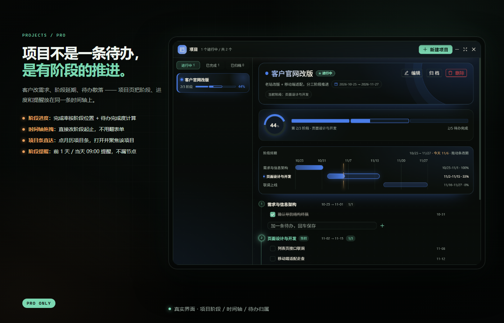
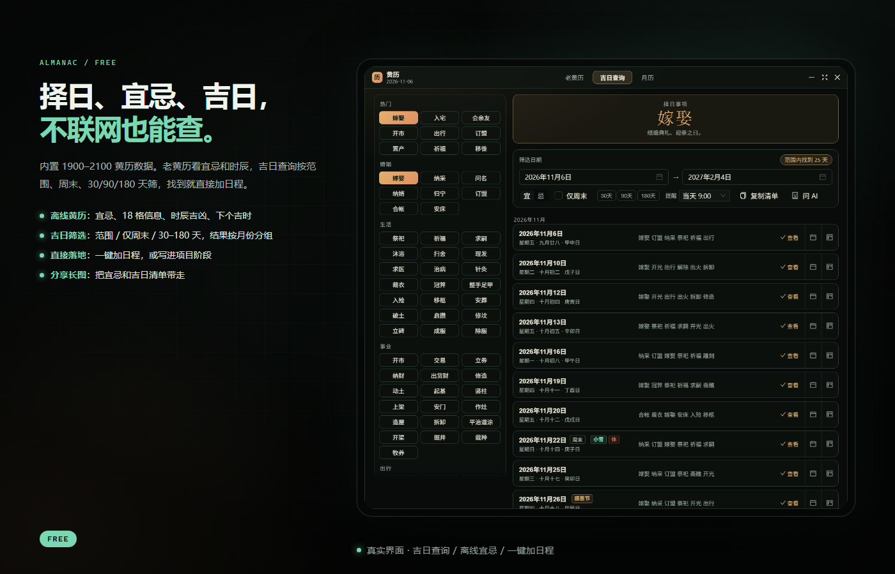
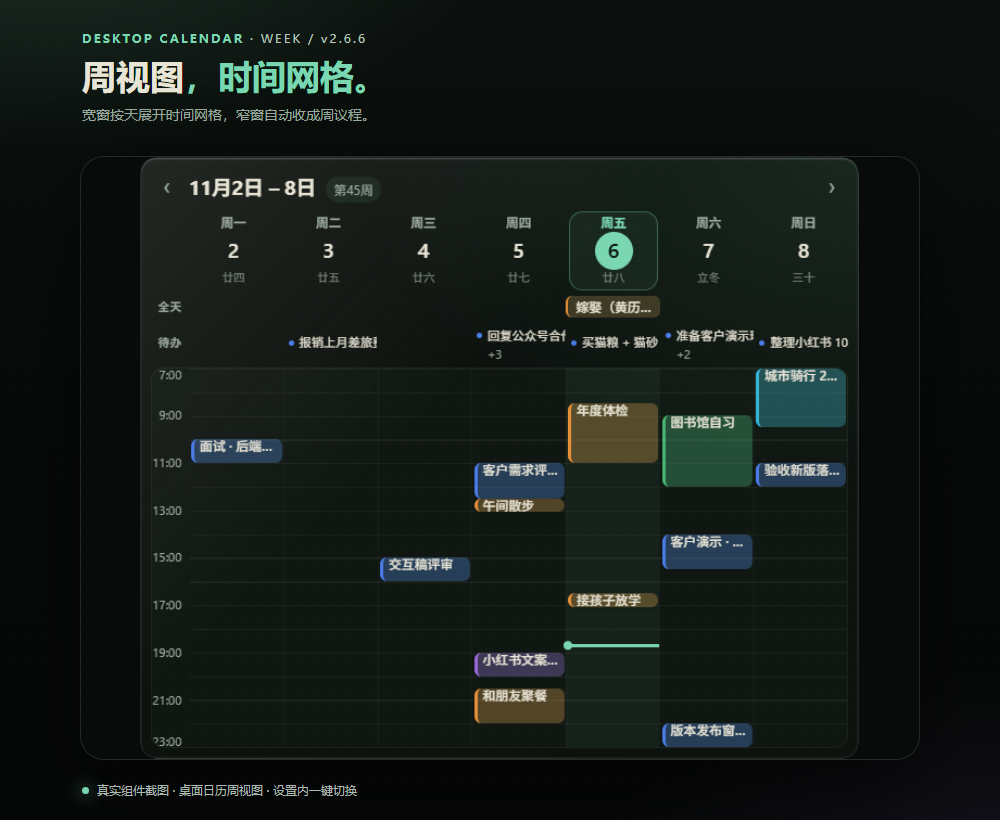
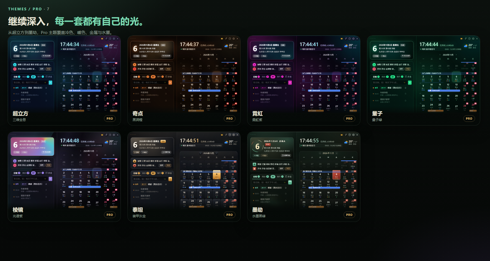
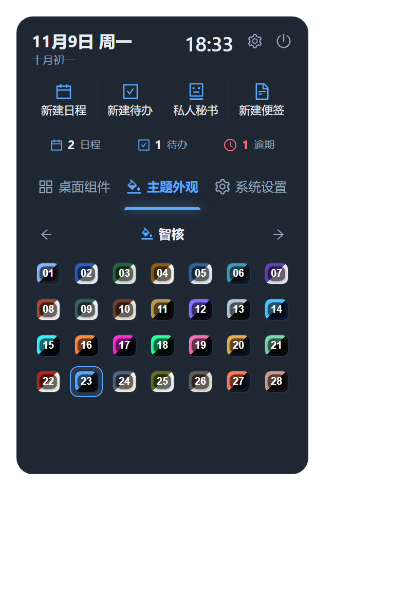
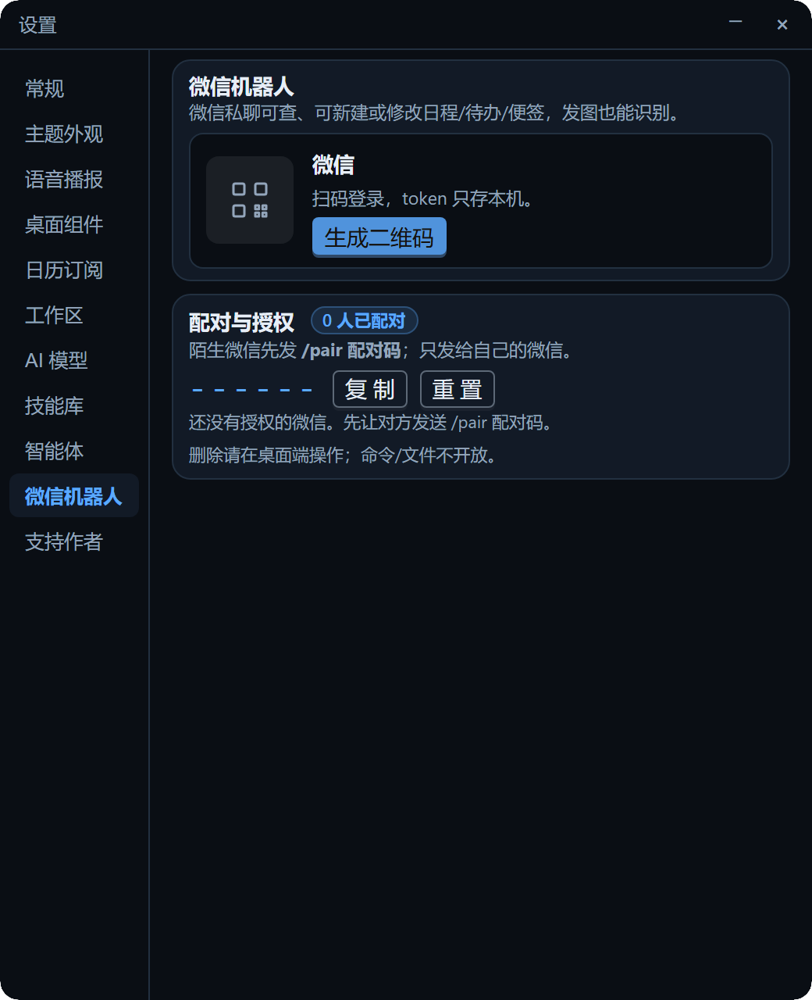

# UCalendar Pro

**Windows 桌面日历 + AI 私人秘书**

日程、待办、项目、黄历、12 个桌面组件和 AI 在同一个桌面。数据存在本机 SQLite，不需要登录，单文件运行。

[下载](https://github.com/tobaba/UCalendar/releases/latest/download/UCalendar.exe) · [官网](https://tobaba.github.io/ucalendar-site/) · [更新记录](https://github.com/tobaba/UCalendar/releases) · [问题反馈](https://github.com/tobaba/UCalendar/issues)


## 下载

| 文件 | 大小 | 说明 |
| --- | --- | --- |
| [UCalendar.exe](https://github.com/tobaba/UCalendar/releases/latest/download/UCalendar.exe) | 9,439,104 字节（9.4 MB） | 免费下载，先体验后支持 |

系统要求：Windows 10 / 11，WebView2 运行时（Win11 与装过 Edge 的系统通常已自带，缺失时首次启动会自动安装）。

安装：下载 exe 后双击运行，不写系统目录。数据默认在 `%LOCALAPPDATA%\UCalendar`；exe 同目录存在 `data\` 时使用便携目录。

## 功能

### 任务栏时钟

左键点任务栏时钟呼出面板，右键是快捷菜单。`Ctrl+Alt+C` 全局热键，托盘常驻，支持开机自启。

### 项目管理

项目不是一条待办，而是一段有阶段的推进。项目页把阶段、进度和提醒放在同一条时间轴上。

| 能力 | 说明 |
| --- | --- |
| 阶段进度 | 完成率 = 阶段位置 + 当前阶段待办完成度；没有待办时不会算出假进度 |
| 时间轴拖拽 | 直接拖动阶段起止改期，不用翻表单 |
| 项目条直达 | 月历项目条显示当前阶段和进度，点击打开并聚焦该项目 |
| 阶段提醒 | 前 1 天 / 当天 09:00 提醒 |
| 归属清晰 | 日程按时间轴独立安排，待办可挂到项目和阶段 |



### 黄历 / 吉日

内置 1900–2100 黄历数据，独立窗查老黄历和吉日，找到日子直接落到日程或项目阶段。

| 能力 | 说明 |
| --- | --- |
| 离线黄历 | 宜忌、18 格信息、时辰吉凶、下个吉时、未来 7 天 |
| 吉日筛选 | 范围 / 仅周末 / 30–180 天，结果按月份分组 |
| 直接落地 | 一键加日程，或写进项目阶段 |
| 分享长图 | 导出宜忌和吉日清单 |



### 12 个桌面组件

组件读同一份数据：主面板改完，桌面上的组件立刻同步。支持拖动、缩放、透明度、锁定、鼠标穿透；收起后汇总到全局胶囊栏。

| 组件 | 说明 |
| --- | --- |
| 月历 | 农历、节气、节假日、日程点；完整月历 / 周视图 / 焦点视图 |
| 今日安排 | 已逾期、待办和日程在同一条时间线上 |
| 天气 | 逐时和 7 天预报 |
| 番茄钟 | 25 分钟专注，绑定任务，结束自动记一轮 |
| 倒计时 | 项目上线、生日、节日 |
| 便签 | 标签、颜色，支持便签管理页 |
| 世界时钟 | 本地时间、农历，加伦敦 / 纽约 / 东京 |
| 秒表 | 分段计时，自动标出最快最慢 |
| 时间进度 | 今天 / 本周 / 本月 / 今年，可看人生进度 |
| 项目进度 | 按截止日排序，进度环、当前阶段、剩余天数 |
| 股票行情 | 自选最多 20 只，实时行情与 K 线，多源回退 |
| 音乐播放 | 接管 Windows 系统媒体会话，封面 / 歌名 / 进度 / 控制 |


<details>
<summary>月历三视图、组件设置与组件截图</summary>





</details>

### 28 套主题

编号 01–28，设置里一屏看全。面板、设置、弹窗和桌面组件同步换肤，支持切换字体与字号。

深色、浅色、护眼、暖阳、粉蓝、黛蓝、浅紫、霞樱、青岚、檀棕、金曜、流光、流银、蓝图、超立方、奇点、霓虹、量子、棱镜、泰坦、墨劫、蒙德里安、智核、洛可可、马卡龙、莫兰迪、马蒂斯、勃艮第。

「智核」为 AI 科技风，主面板顶部是翻页时钟；默认主题为「墨劫」。


<details>
<summary>主题截图</summary>





</details>

### AI 小秘书

```text
你：明天下午三点开会，提前 15 分钟提醒我
AI：已创建「开会」15:00（提醒 14:45），要现在写入吗？
你：好
AI：已写入日历
```

| 能力 | 说明 |
| --- | --- |
| 一句话建日程 | 时间、地点、重复、提醒一次识别 |
| 会查也会改 | 查真实空档再动手，改期、改提醒 |
| 日报 / 周报 / 月报 / 年报 | 按真实日程与待办生成 Markdown |
| 8 个预设助手 | 今日参谋、日程秘书、日迹分析师、待办管家、研究员、周报官、月报官、年报官；也可自建 |
| 多服务商 | DeepSeek、任意 OpenAI 兼容接口、Claude；Key 只存本机 |
| 技能调用 | 工作区 `skills/` 放技能说明，输入 `/` 选择并注入 |
| 安全边界 | 写日程、删数据、执行命令都要确认；文件操作限定在工作目录 |
| 自动朗读 | 整点报时、久坐提醒、日程提醒，可换音色与语速 |


### 微信机器人

运行时扫码绑定微信，私聊即可查询和修改日程、待办、便签，发图片交给 AI 识别。陌生微信先发 `/pair 配对码` 才能用；token 只存本机，关闭 UCalendar 即停止服务。

常用指令：`/today` `/weather` `/almanac` `/news` `/new` `/stop` `/support`



### 其他细节

<details>
<summary>展开</summary>

- **提醒**：日程 / 待办可设多个提前提醒点，同一时刻只提醒一次，Toast 可推迟，旧数据自动兼容
- **置顶待办**：星标最多 3 条，固定在「今日安排」顶部和主面板待办列表
- **待办子任务**：最多 50 项，列表显示 `2/5`，重复待办下一期自动重置勾选
- **统一回收站**：日程 / 待办 / 便签删除后保留 30 天，可搜索、恢复、彻底删除
- **便签管理**：SQLite 持久化，搜索、标签、星标、批量整理、Markdown 导出
- **日迹与时间册**：记录心情、能量和一句话，AI 复盘；单日或范围导出
- **今日节奏**：本地日计划、专注完成提示、近 7 天专注周报
- **日历**：农历 / 节气 / 节假日调休 / 黄历宜忌；日程支持自然语言输入与重复规则
- **语音播报**：整点报时、久坐提醒、日程提醒，可换音色与语速
- **入口**：左键任务栏时钟呼出面板，右键自绘快捷卡片，`Ctrl+Alt+C` 全局热键，支持开机自启
- **数据**：默认在 `%LOCALAPPDATA%\UCalendar`；exe 同目录有 `data\` 时用便携目录

</details>

## 支持

日程和待办一直免费，没有广告、不订阅、不联网。20 元起自愿支持，一次支持长期可用：

- 项目管理：项目阶段、月历项目条、时间轴、阶段到期提醒
- 便签管理页：搜索、标签、星标、批量整理
- 今日节奏：本地日计划、专注完成提示、近 7 天专注周报
- 世界时钟、秒表、时间进度、工作区预设
- 28 套主题
- 前 100 位记为创始支持者，其余为同行者（可匿名）
- 优先答疑，作者亲自回复

操作：面板右下角「怎么支持」→ 扫微信赞赏码并留下邮箱 → 收到支持码后填回同一页面。

## 开发与构建

```powershell
cd UCalendar.Web
npm install
cd ..
.\UCalendar.Web\node_modules\.bin\tauri build --no-bundle
# 产物：src-tauri/target/release/UCalendar.exe
```

技术栈：Tauri 2.12.5、Rust（rusqlite / rustls / Ed25519）、React 19 + antd、Vite。

## 常见问题

<details>
<summary>杀毒软件或系统提示未知发布者？</summary>

使用 `CN=UCalendar Studio` 代码签名。SmartScreen 首次运行仍可能提示，可从 Releases 下载并核对文件大小。

</details>

<details>
<summary>支持码是订阅吗？</summary>

不是。20 元起自愿支持，一次支持长期可用，一人一码。

</details>

<details>
<summary>AI 功能必须联网吗？</summary>

需要 API Key 与你选择的服务商。不配置时其余功能照常使用。

</details>

<details>
<summary>换电脑怎么迁移数据？</summary>

便携模式直接复制整个程序文件夹；数据在 `%LOCALAPPDATA%\UCalendar` 时复制该目录。

</details>

<details>
<summary>支持哪些系统？</summary>

Windows 10 / 11 为官方支持。macOS 源码可构建，暂无官方安装包。

</details>