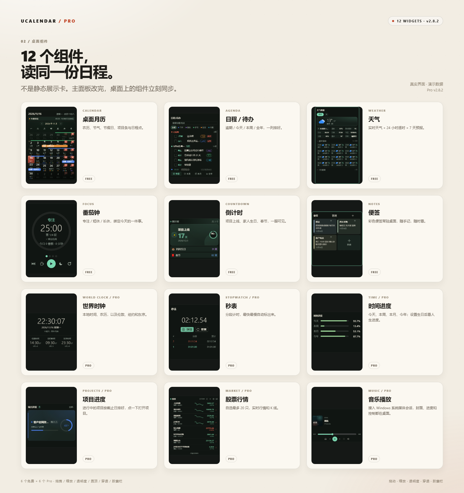
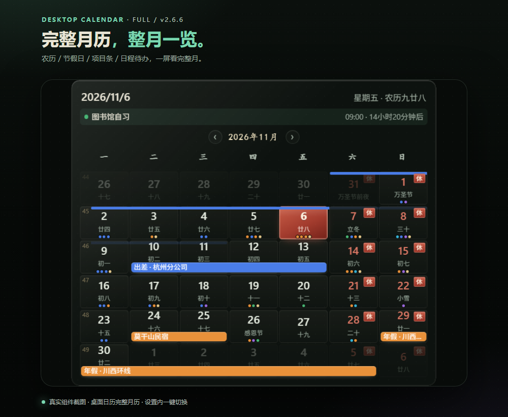
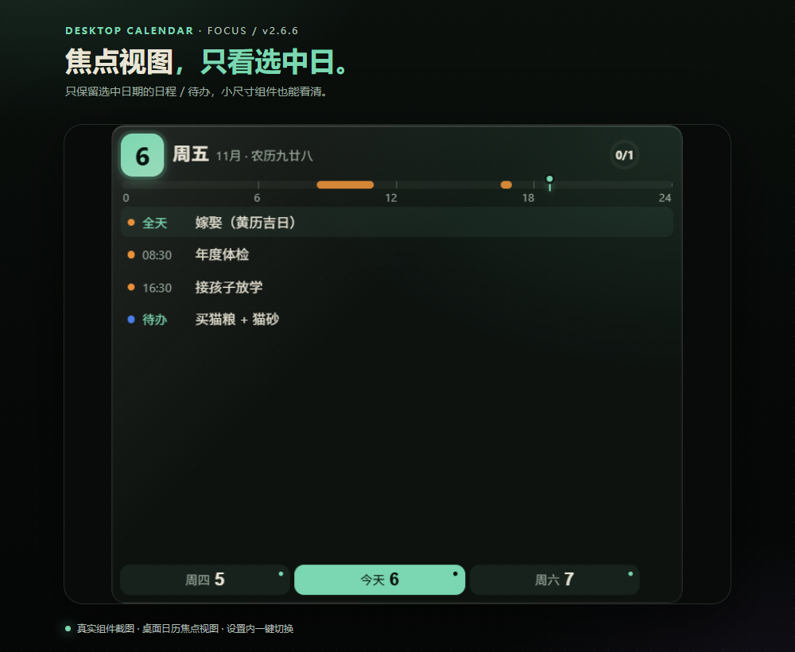
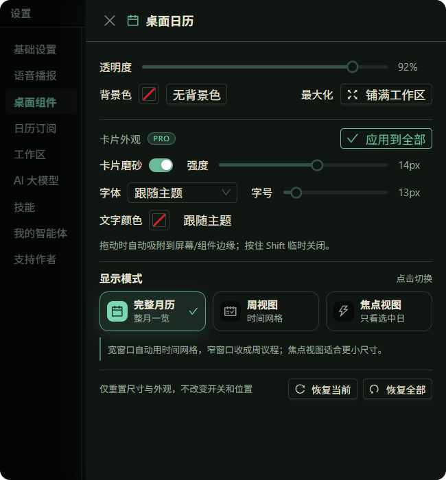
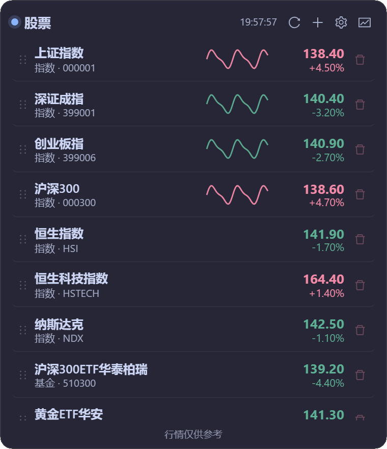
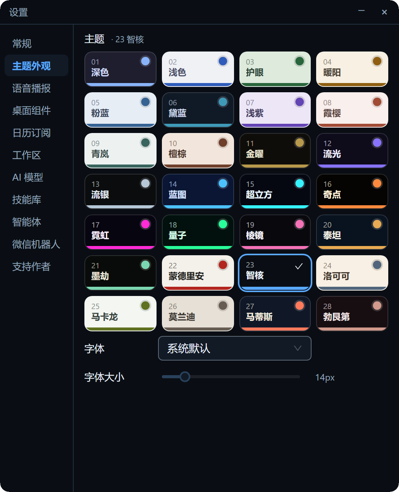
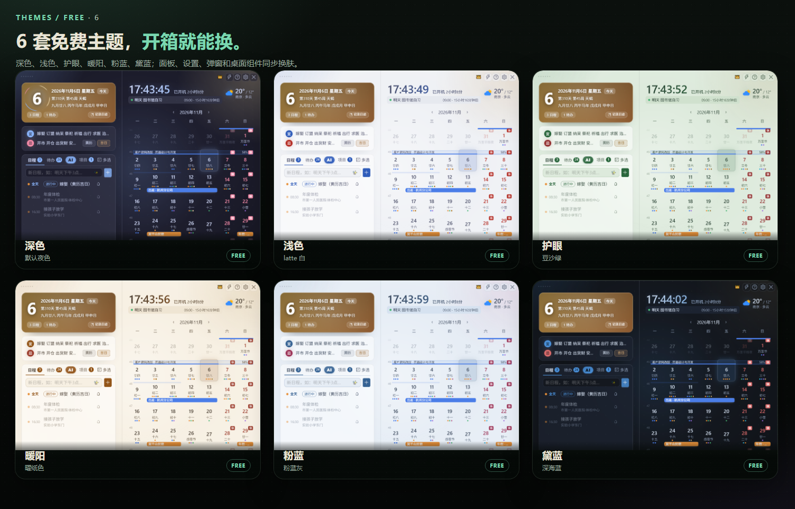

<p align="center">
  
</p>

<p align="center">
  <b>Windows 桌面日历 + AI 私人秘书</b><br>
  日程、待办、项目、黄历、桌面组件和 AI 都在同一张桌面；本地 SQLite，不登录，单文件约 9.4 MB。
</p>

<p align="center">
  <a href="https://github.com/tobaba/UCalendar/releases/latest/download/UCalendar.exe"></a>
  <a href="https://github.com/tobaba/ucalendar-lite/releases/latest/download/UCalendar-Lite.exe"></a>
  <a href="https://tobaba.github.io/ucalendar-site/"></a>
</p>

<p align="center">
  [概览](#概览) · [下载](#下载) · [组件](#12-个桌面组件) · [主题](#28-套主题) · [AI](#ai-小秘书) · [支持](#怎么支持) · [FAQ](#常见问题)
</p>

## 概览

<table>
<tr>
<td width="56%"></td>
<td width="44%">
<ul>
<li><b>任务栏时钟即入口</b>：左键呼出面板，右键快捷菜单；<code>Ctrl+Alt+C</code> 全局热键，托盘常驻</li>
<li><b>12 个桌面组件</b>：月历、今日安排、天气、番茄钟、倒计时、便签、世界时钟、秒表、时间进度、项目进度、股票、音乐</li>
<li><b>会动手的 AI</b>：一句话建日程、查空、改期、写周报；先查真实数据，写入前确认</li>
<li><b>项目不是一条待办</b>：阶段、进度、时间轴拖拽改期，月历项目条直达</li>
<li><b>黄历 / 吉日</b>：1900–2100 离线宜忌、时辰吉凶、吉日筛选，找到日子直接加日程</li>
<li><b>本地优先</b>：数据默认在 <code>%LOCALAPPDATA%\UCalendar</code>；exe 同目录有 <code>data\</code> 时自动用便携目录</li>
</ul>
</td>
</tr>
</table>

| 平台 | 安装 | 数据 | AI | 版本 |
| --- | --- | --- | --- | --- |
| Windows 10 / 11 | 单文件 exe，免安装 | 本地 SQLite，无账号 | 自带 Key，可选服务商 | Pro 9.4 MB · Lite 8.8 MB |

## 下载

**Pro v2.8.2**（约 9.4 MB，免费下载，先体验后支持）：[下载 UCalendar.exe](https://github.com/tobaba/UCalendar/releases/latest/download/UCalendar.exe)

**Lite v2.8.2**（约 8.8 MB，永久免费）：[下载 UCalendar-Lite.exe](https://github.com/tobaba/ucalendar-lite/releases/latest/download/UCalendar-Lite.exe)

1. 下载 exe，双击运行，无需安装
2. 左键点任务栏时钟呼出面板；右键时钟是快捷卡片
3. 数据默认在 `%LOCALAPPDATA%\UCalendar`；程序目录不可写时自动回退

运行要求：Windows 10 / 11 + WebView2 运行时（Win11 与装过 Edge 的系统通常已自带；缺失时首次启动会联网安装）。

**Lite 与 Pro 的边界**：Lite 保留日程、待办、月历、今日安排、黄历吉日、便签、6 个桌面组件、6 套主题与 AI；项目管理、便签管理、日迹、时间册导出、今日节奏、微信机器人、6 个 Pro 专属组件、工作区预设和 22 套高级主题属于 Pro。两个版本数据互通。

## 项目管理（Pro）

**项目不是一条待办，是一段有阶段的推进。** 客户改需求、阶段延期、待办散落——项目页把阶段、进度和提醒放在同一条时间轴上。

| 能力 | 说明 |
| --- | --- |
| 阶段进度 | 完成率 = 阶段位置 + 当前阶段待办完成度；没有待办时也不会算假进度 |
| 时间轴拖拽 | 直接拖动阶段起止改期，不用翻表单 |
| 项目条直达 | 月历上的项目条显示当前阶段和进度，点一下打开并聚焦该项目 |
| 阶段提醒 | 前 1 天 / 当天 09:00 提醒，节点不漏 |
| 归属清晰 | 日程按时间轴独立安排；待办能挂到项目和阶段 |

## 黄历 / 吉日（免费）

**择日不靠翻网页，宜忌不靠猜。** 内置 1900–2100 黄历数据，独立窗查老黄历和吉日；找到日子直接落到日程或项目阶段。

| 能力 | 说明 |
| --- | --- |
| 离线黄历 | 宜忌、18 格信息、时辰吉凶、下个吉时、未来 7 天 |
| 吉日筛选 | 范围 / 仅周末 / 30–180 天，结果按月份分组 |
| 直接落地 | 一键加日程，或写进项目阶段 |
| 分享长图 | 把宜忌和吉日清单带走 |
| 两个版本都能用 | Lite 也包含黄历 / 吉日，不联网也能查 |

## 12 个桌面组件

<p align="center">
  
</p>

| 组件 | 说明 | 版本 |
| --- | --- | --- |
| 月历 | 农历、节气、节假日、日程点；支持完整月历 / 周视图 / 焦点视图 | Lite |
| 今日安排 | 今天几点做什么；已逾期、待办和日程在同一条时间线上 | Lite |
| 天气 | 逐时和 7 天预报；出门前不用再开网页 | Lite |
| 番茄钟 | 25 分钟专注，绑定今天的一件事；结束自动记一轮 | Lite |
| 倒计时 | 项目上线、家人生日、春节；重要日子有数 | Lite |
| 便签 | 随手记，支持标签和颜色；桌面便签长期免费 | Lite |
| 世界时钟 | 本地时间、农历，再加伦敦、纽约和东京；跨时区开会不心算 | Pro |
| 秒表 | 分段计时；最快最慢自动标出来 | Pro |
| 时间进度 | 今天、本周、本月、今年走了多少；设置生日后还能看人生进度 | Pro |
| 项目进度 | 进行中项目按截止日排好；进度环、当前阶段和剩余天数一眼看到 | Pro |
| 股票行情 | 自选最多 20 只，实时行情和 K 线；东财优先，镜像与 stale 自动回退 | Pro |
| 音乐播放 | 接入 Windows 系统媒体会话，封面、歌名、进度和播放控制都在桌面 | Pro |

组件支持拖拽、缩放、透明度、锁定、鼠标穿透；收起后汇总到全局胶囊栏，点击或悬停展开，支持拖动排序和全部展开。全部组件读同一份数据：主面板改完，桌面上的组件立刻同步。

<details>
<summary>展开：月历三视图、组件设置与 Pro 组件截图</summary>

<p align="center">
  
  
  
</p>

<p align="center">
  
</p>

<p align="center">
  
  
  
</p>

<p align="center">
  
</p>

</details>

## 28 套主题

<p align="center">
  
</p>

从深色、浅色、护眼、暖阳到智核、蒙德里安、勃艮第，编号 01–28，设置里一屏看全。面板、设置、弹窗和桌面组件同步换肤；支持切换字体与字号。

| 版本 | 主题 |
| --- | --- |
| 6 套免费 | 深色、浅色、护眼、暖阳、粉蓝、黛蓝 |
| 22 套 Pro | 浅紫、霞樱、青岚、檀棕、金曜、流光、流银、蓝图、超立方、奇点、霓虹、量子、棱镜、泰坦、墨劫、蒙德里安、智核、洛可可、马卡龙、莫兰迪、马蒂斯、勃艮第 |
| 默认主题 | Pro 首启「墨劫」，未解锁高级主题时回退「粉蓝」；Lite 首启「深色」 |

<details>
<summary>展开：免费与 Pro 主题截图</summary>

<p align="center">
  
</p>

<p align="center">
  
  
</p>

<p align="center">
  
</p>

</details>

## AI 小秘书

```text
你：明天下午三点开会，提前 15 分钟提醒我
AI：已创建「开会」15:00（提醒 14:45），要现在写入吗？
你：好
AI：已写入日历
```

<p align="center">
  
</p>

| 能力 | 说明 |
| --- | --- |
| 一句话建日程 | 「明天下午三点开会 在会议室 A」「每周一晨会」——时间、地点、重复、提醒一次识别 |
| 会查也会改 | 问「这周还有哪些空？」「把周四的健身改到晚上 8 点」，查真实数据再动手 |
| 日报 / 周报 / 月报 / 年报 | 按真实日程与待办生成 Markdown，不用自己回忆 |
| 8 个预设助手 | 今日参谋、日程秘书、日迹分析师、待办管家、研究员、周报官、月报官、年报官；也能一句话自建助手 |
| 多服务商 | DeepSeek、任意 OpenAI 兼容接口、Claude；Key 自己填，只存本机 |
| 技能调用 | 工作区 `skills/` 放技能说明，输入 `/` 直接选择并注入；`Ctrl+Alt+A` 打开私人秘书 |
| 安全边界 | 写日程、删数据、执行命令都要确认；文件操作限定在工作目录 |
| 自动朗读 | 到点按设置语音播报，像个真的秘书 |

### 微信机器人（Pro）

UCalendar 运行时扫码绑定微信，私聊即可查询和修改日程、待办、便签，发图片还能交给 AI 识别。陌生微信先发 `/pair 配对码` 才能用；token 只存本机，关闭 UCalendar 即停止服务。

常用指令：`/today` `/weather` `/almanac` `/news` `/new` `/stop` `/support`

<details>
<summary>展开：AI 与微信机器人截图</summary>

<p align="center">
  
</p>

</details>

## 细节

<details>
<summary>展开：提醒、待办、回收站、数据与主题细节</summary>

- **提醒 2.0**：日程 / 待办可设多个提前提醒点，同一时刻只提醒一次，Toast 可推迟，旧数据自动兼容
- **置顶待办**：星标最多 3 条，固定在「今日安排」顶部和主面板待办列表，完成 / 删除自动清理
- **待办子任务**：大事拆成小步骤（最多 50 项），列表显示 `2/5`，重复待办下一期自动重置勾选
- **统一回收站**：日程 / 待办 / 便签删除后保留 30 天，可搜索、恢复、彻底删除
- **便签落库**：SQLite 持久化，支持标签、删除进回收站、Markdown 导出，旧 localStorage 自动迁移
- **项目阶段**：项目和阶段、待办归属；月历项目条、项目页时间轴、阶段到期提醒，点项目条直达项目窗口
- **日历**：农历 / 节气 / 节假日调休 / 黄历宜忌；日程支持自然语言输入、重复规则
- **日历视图**：桌面日历可切完整月历 / 周视图 / 焦点视图；周视图宽窗时间网格、窄窗自动收成周议程，设置内可“应用到全部 / 恢复全部”组件外观
- **黄历 / 吉日**：独立窗查 1900–2100 宜忌与释义，离线可用；吉日可直接加日程或写项目阶段
- **语音播报**：整点报时、久坐提醒、日程提醒，可换音色与语速，报时文案支持变量
- **主题**：28 套（深色 / 浅色 / 护眼 / 暖阳 / 粉蓝 / 黛蓝 / 浅紫 / 霞樱 / 青岚 / 檀棕 / 金曜 / 流光 / 流银 / 蓝图 / 超立方 / 奇点 / 霓虹 / 量子 / 棱镜 / 泰坦 / 墨劫 / 蒙德里安 / 智核 / 洛可可 / 马卡龙 / 莫兰迪 / 马蒂斯 / 勃艮第），编号 01–28；「智核」顶部为翻页时钟
- **默认主题**：Pro 首启「墨劫」（未解锁高级主题时回退「粉蓝」），Lite 首启「深色」；已经选过主题的用户保持自己的选择
- **面板入口**：日程 / 待办 / AI / 项目 / 多选一屏可达；AI 用紧凑胶囊按钮，随主题换色，不挤占工具行
- **入口**：左键任务栏时钟呼出面板，右键是自绘快捷卡片，托盘图标常驻，`Ctrl+Alt+C` 全局热键，支持开机自启
- **数据**：默认在 `%LOCALAPPDATA%\UCalendar`；exe 同目录有 `data\` 时使用便携目录，拷走文件夹 = 带走全部数据

</details>

## 怎么支持

日程和待办一直免费，没有广告、不订阅、不联网。20 元起自愿支持，感谢回馈 **UCalendar Pro**：

- 解锁「项目管理」：项目阶段、月历项目条、时间轴、阶段到期提醒
- 解锁「便签管理页」：搜索、标签、星标、批量整理
- 解锁「今日节奏」：本地确定性日计划 + 专注完成提示 + 近 7 天专注周报
- 解锁世界时钟、秒表、时间进度与「工作区预设」
- 解锁 22 套高级主题
- 前 100 位记为**创始支持者**，其余为**同行者**（可匿名）
- 优先答疑，作者亲自回复（附《用户手册》）

操作：面板右下角「怎么支持」→ 扫微信赞赏码并留下邮箱 → 收到支持码后填回同一页面。

<p align="center">
  
</p>

## 源码

```powershell
cd UCalendar.Web
npm install
cd ..
.\UCalendar.Web\node_modules\.bin\tauri build --no-bundle
# 产物：src-tauri/target/release/UCalendar.exe
```

技术栈：Tauri 2.12.5 · Rust（rusqlite / rustls / Ed25519）· React 19 + antd · Vite。

## 常见问题

<details>
<summary>杀毒 / 系统提示未知发布者？</summary>
Pro 与 Lite 单文件均使用 <code>CN=UCalendar Studio</code> 代码签名；SmartScreen 首次运行仍可能提示，可从 Releases 下载并核对文件大小。
</details>

<details>
<summary>AI 功能必须联网吗？</summary>
需要 API Key 与你选择的服务商；不配置时其余功能照常使用。
</details>

<details>
<summary>换电脑怎么迁移数据？</summary>
便携模式直接复制整个程序文件夹；数据在 <code>%LOCALAPPDATA%\UCalendar</code> 时复制该目录。
</details>

<details>
<summary>支持哪些系统？</summary>
Windows 10 / 11 为官方支持；macOS 源码已支持，暂无官方构建。
</details>

---

<p align="center">
  <a href="https://github.com/tobaba/UCalendar/issues">Issues</a>
  &nbsp;·&nbsp;
  <a href="https://github.com/tobaba/UCalendar/releases">Releases</a>
  &nbsp;·&nbsp;
  <a href="https://tobaba.github.io/ucalendar-site/">Website</a>
  &nbsp;·&nbsp;
  <a href="mailto:tobestway@foxmail.com">tobestway@foxmail.com</a>
</p>

<p align="center"><sub>如果它每天帮你省下那几次切窗口 —— Star 就是最实在的支持</sub></p>