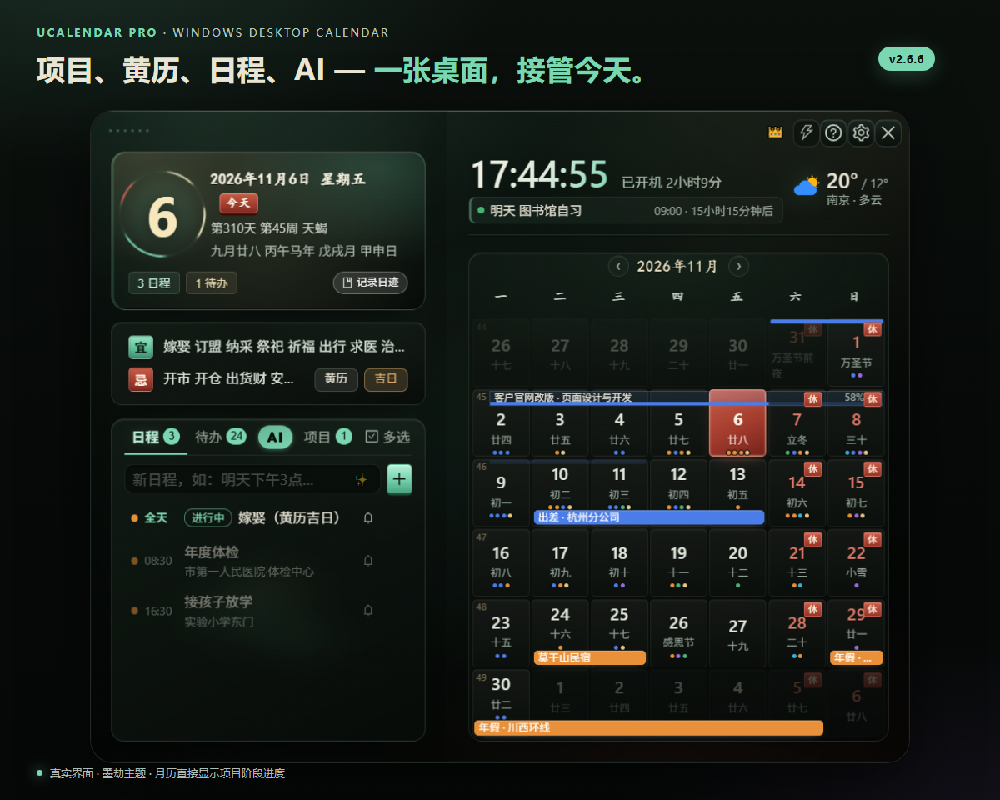

# UCalendar Pro

> 任务栏上的日历，会动手的 AI 秘书。

把日程、待办、项目和桌面组件放在同一张桌面。说一句就改，改完还能撤回。



## 功能

**项目管理。** 阶段、进度、时间轴拖拽改期，月历项目条直达。完成率 = 阶段位置 + 当前阶段待办完成度，没有待办时不会算出假进度。

**12 个桌面组件。** 月历、今日安排、天气、番茄钟、倒计时、便签、世界时钟、秒表、时间进度、项目进度、股票行情、音乐播放。组件读同一份数据，主面板改完桌面同步；支持拖动、缩放、透明度、锁定和鼠标穿透。

**AI 小秘书。** 一句话建日程、查空、改期、写周报。先查真实数据，写入前确认，改错可撤销。支持 DeepSeek、任意 OpenAI 兼容接口和 Claude，Key 只存本机。

**微信机器人。** 扫码绑定微信，私聊查改日程、待办、便签，发图片交给 AI 识别。token 只存本机，关掉 UCalendar 即停止服务。

**日迹与时间册。** 记录心情、能量和一句话，AI 复盘找模式；单日或范围导出这一天。

**今日节奏。** 按精力安排今天，附专注完成提示和近 7 天专注周报。

**黄历 / 吉日。** 1900–2100 离线宜忌、时辰吉凶、吉日筛选，找到日子直接加日程或写进项目阶段。

**28 套主题。** 面板、设置、弹窗和桌面组件同步换肤，支持切换字体与字号。「智核」为 AI 科技风，主面板顶部是翻页时钟。

**任务栏入口。** 左键点时钟呼出面板，右键是快捷菜单。`Ctrl+Alt+C` 全局热键，托盘常驻，支持开机自启。

## 截图


## 下载

| 文件 | 大小 | 说明 |
| --- | --- | --- |
| [UCalendar.exe](https://github.com/tobaba/UCalendar/releases/latest/download/UCalendar.exe) | 9,439,104 字节（9.4 MB） | 免费下载，先体验后支持 |

系统要求：Windows 10 / 11，WebView2 运行时（Win11 与装过 Edge 的系统通常已自带，缺失时首次启动会自动安装）。

安装：下载 exe 后双击运行，不写系统目录。数据默认在 `%LOCALAPPDATA%\UCalendar`；exe 同目录存在 `data\` 时使用便携目录。

## 开发与构建

```powershell
cd UCalendar.Web
npm install
cd ..
.\UCalendar.Web\node_modules\.bin\tauri build --no-bundle
# 产物：src-tauri/target/release/UCalendar.exe
```

技术栈：Tauri 2.12.5、Rust（rusqlite / rustls / Ed25519）、React 19 + antd、Vite。

## 常见问题

<details>
<summary>杀毒软件或系统提示未知发布者？</summary>

使用 `CN=UCalendar Studio` 代码签名。SmartScreen 首次运行仍可能提示，可从 Releases 下载并核对文件大小。

</details>

<details>
<summary>支持码是订阅吗？</summary>

不是。20 元起自愿支持，一次支持长期可用，一人一码。

</details>

<details>
<summary>AI 功能必须联网吗？</summary>

需要 API Key 与你选择的服务商。不配置时其余功能照常使用。

</details>

<details>
<summary>换电脑怎么迁移数据？</summary>

便携模式直接复制整个程序文件夹；数据在 `%LOCALAPPDATA%\UCalendar` 时复制该目录。

</details>

<details>
<summary>支持哪些系统？</summary>

Windows 10 / 11 为官方支持。macOS 源码可构建，暂无官方安装包。

</details>

## 支持

日程和待办一直免费，没有广告、不订阅、不联网。20 元起自愿支持，一次支持长期可用。

操作：面板右下角「怎么支持」→ 扫微信赞赏码并留下邮箱 → 收到支持码后填回同一页面。前 100 位记为创始支持者，其余为同行者（可匿名），优先答疑，作者亲自回复。