# UCalendar

**Windows 桌面日历 · 会动手的 AI 小秘书 · 任务栏时钟 · 8 个桌面组件**

一句话让 AI 建日程、查空闲、改期、写周报；日历、日程、待办、黄历、天气住在桌面上，任务栏时钟点开就是今天。单文件绿色版，双击即用。

[](https://github.com/tobaba/UCalendar/releases/latest)
[](#ai-小秘书真的会动手)


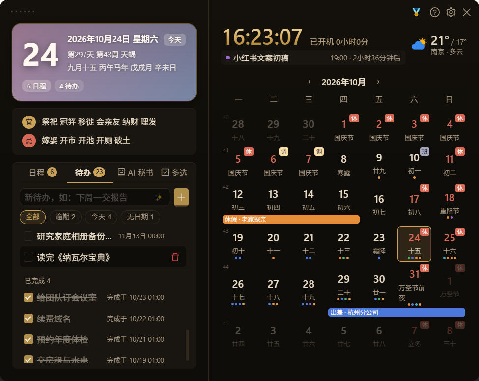

## 这些场景，你中了几条？

- 任务栏时钟只是一串数字——今夕何夕、农历几号、今天有没有会，还得点开别的东西看；
- 日历在系统自带里、日程在清单应用里、待办在便签里、天气在手机里，**一天要切四个地方**；
- 想给桌面挂个日历/待办，不是太丑，就是要求登录、绑定、订阅；
- 装了 AI 助手，只会陪你聊——**「明天下午三点开会」它不会真的帮你建进日历**；
- 免费工具要么带广告，要么把习惯数据往云端传。

UCalendar 就是把这些事收进**同一个常驻桌面的小面板**：左键点任务栏时钟，它就在时钟上方展开；不点开时，安静得像不存在。

## AI 小秘书：真的会动手


不是陪你聊天的机器人——它读得到你的日历与待办，确认后直接写进去：

```text
你：明天下午三点开会，提前 15 分钟提醒我
AI：已创建「开会」10 月 21 日 15:00（提醒 14:45），要现在写入吗？
你：好
AI：已写入日历 ✅
```

- **一句话建日程**：「明天下午三点开会 在会议室 A」「每周一晨会」——时间、地点、重复、提醒一次识别
- **会查也会改**：问「这周还有哪些空？」「把周四的健身改到晚上 8 点」，查真实数据再动手
- **日报 / 周报 / 月报 / 年报**：按真实日程与待办生成 Markdown，不用自己回忆
- **6 个预设助手**：今日参谋、日程秘书、待办管家、周报官、月报官、年报官，一键切换；也能一句话自建专属助手
- **多服务商**：DeepSeek、任意 OpenAI 兼容接口、Claude 均可；Key 自己填，只存本机
- **安全边界**：写日程、删数据、执行命令都要弹窗确认；文件操作限定在工作目录

## 一眼看懂

- **任务栏时钟即入口**：左键呼出面板，右键是快捷菜单（打开日历 / 打开设置 / 私人秘书 / 桌面组件开关 / 解除穿透 / 开机启动 / 退出）；日期行可自选「年月日 / 带星期 / 跟随系统」，Win10 小任务栏按钮下会自动切回普通高度
- **桌面组件 8 种**：需要一直看见的东西，挂在桌面上
- **AI 与日历同一份数据**：它读写的就是你看到的日程与待办，不另存一份
- **单文件、不登录、数据全在本机**：删掉 exe 即卸载（`data\` 一并删除即可）

## 桌面组件（8 种，随放随用）

<table>
<tr>
<td width="50%" align="center">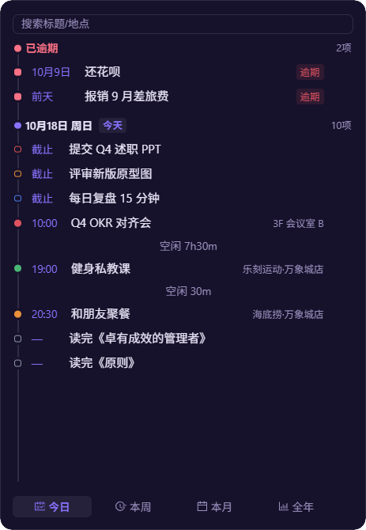<br><b>今日安排</b><br>逾期 / 今天 / 本周 / 本月 / 全年五档视图，日程与待办按时间排好，空闲时段一目了然</td>
<td width="50%" align="center">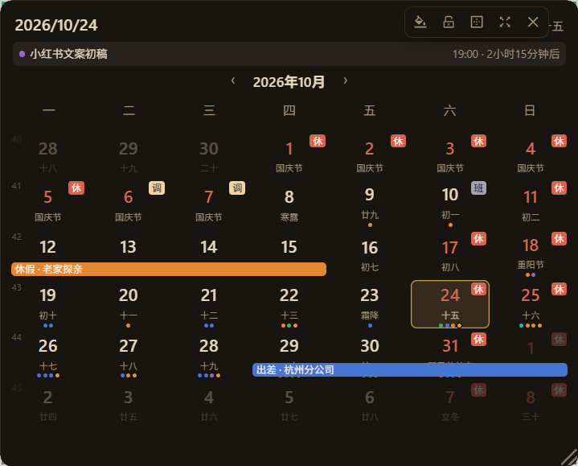<br><b>桌面月历</b><br>农历、节气、节假日调休、跨天日程条与日程圆点，一眼看完整月</td>
</tr>
<tr>
<td align="center">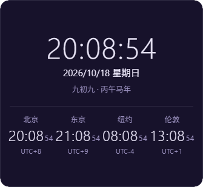<br><b>世界时钟</b><br>北京 / 东京 / 纽约 / 伦敦，最多 4 城，附 UTC 差与农历</td>
<td align="center">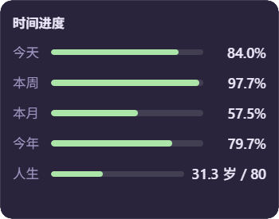<br><b>时间进度</b><br>今天、本周、本月、今年与人生进度条，提醒时间去哪了</td>
</tr>
<tr>
<td align="center">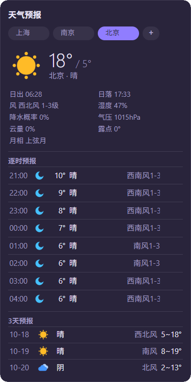<br><b>天气预报</b><br>实时天气 + 24 小时逐时 + 3 天预报，多城市切换</td>
<td align="center">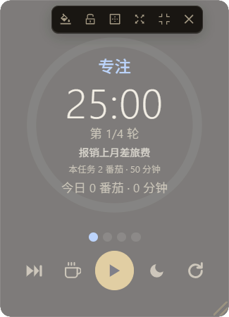<br><b>番茄钟</b><br>专注 / 短休 / 长休周期可调，结束自动播报</td>
</tr>
<tr>
<td align="center">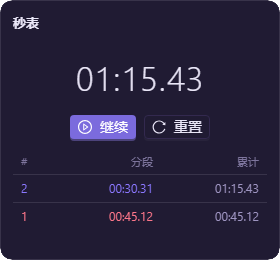<br><b>秒表</b><br>百分之一秒精度，分段计次，关窗不丢状态</td>
<td align="center">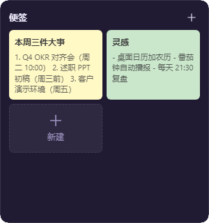<br><b>待办便笺</b><br>随手记的彩色便签，常驻桌面，不用打开主面板</td>
</tr>
</table>

全部组件支持：拖动、缩放、透明度、锁定位置、鼠标穿透（不挡桌面操作）。

## 12 套主题

内置 10 套通用主题（深色 / 浅色 / 护眼 / 暖阳 / 粉蓝 / 浅紫 / 霞樱 / 青岚 / 黛蓝 / 檀棕），外加两套支持者专属主题：**「金曜」黑金**与**「流光」极光紫**。整界面（面板、设置、小组件、弹窗）统一换肤。

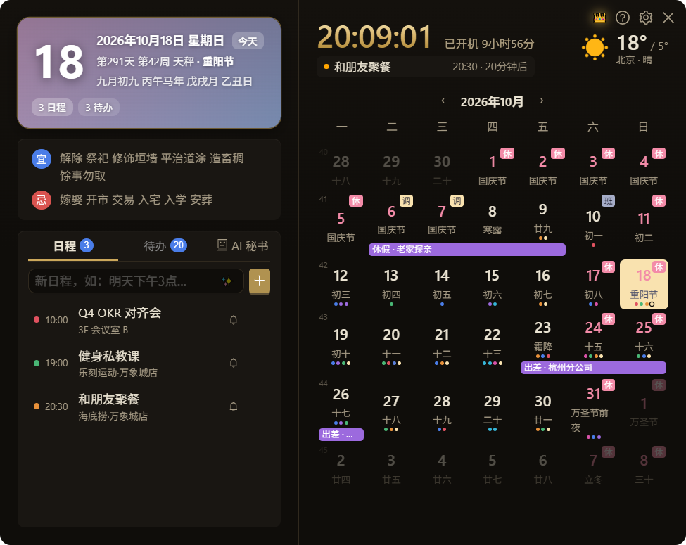

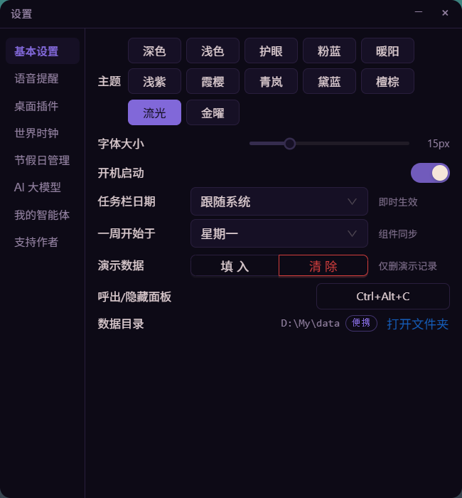

## 日历与提醒

- 月历 + **农历 / 节气 / 节假日调休 / 黄历宜忌**，今天适合做什么一眼看懂
- 日程支持自然语言输入、重复规则、提前提醒；待办四档优先级、逾期标记
- **语音播报**：整点报时、久坐提醒、日程提醒，可换音色、语速，报时文案支持变量（时间 / 农历 / 宜忌 / 下一个日程）
- 全局热键呼出（默认 `Ctrl+Alt+C`）、开机自启；常驻任务栏时钟（macOS 为菜单栏图标，无系统托盘）

---

## 下载

**[下载最新版本](https://github.com/tobaba/UCalendar/releases/latest/download/UCalendar.exe)**（约 7.7 MB）

1. 下载 `UCalendar.exe`，双击运行，**无需安装**
2. 左键点任务栏时钟呼出面板；右键时钟是快捷菜单
3. 数据默认保存在 exe 同目录的 `data\` 里（便携/绿色版，拷走文件夹=带走全部数据）；首次运行会自动从 `%LOCALAPPDATA%\UCalendar` 迁移旧数据（保留备份）。程序目录不可写时自动回退 `%LOCALAPPDATA%`，删除 exe 即卸载

运行要求：Windows 10 / 11（需要 WebView2 运行时；Win11 与装过 Edge 的系统已自带）。

---

## 支持作者

软件免费、没有广告，免费功能永远不受影响。

支持作者可以：

- 🚀 **持续更新**：新功能与问题修复持续推进；
- 💬 **优先答疑**：使用上遇到疑问来信直接问作者（回复附《用户手册》）；
- 🛠️ **专属定制**：支持者可提需求并优先排期（组件 / 主题 / 导出格式等，作者直接对接）；
- 🏆 **荣耀榜**：名字（或昵称 / 匿名）登上 [支持者荣耀榜](SUPPORTERS.md)；
- 🎖️ 等级徽章（🛡️ 守护者 / 🏅 荣光支持者 / 👑 传奇支持者）与专属主题「流光」「金曜」，可后续升级等级。

**怎么支持**：面板右下角 ☕ →「怎么支持」，扫微信赞赏码、在赞赏留言里写下邮箱，作者把支持码发到你的邮箱；把支持码填回同一页面即可。

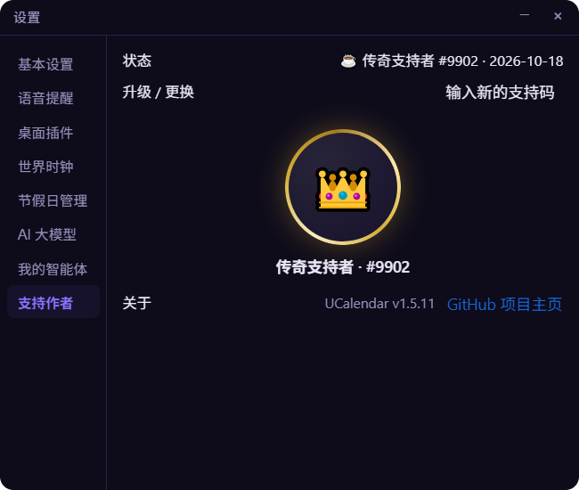

## 从源码构建

```powershell
cd UCalendar.Web
npm install
cd ..
.\UCalendar.Web\node_modules\.bin\tauri build --no-bundle   # 产物：src-tauri/target/release/UCalendar.exe
```

技术栈：Tauri 2 · Rust（rusqlite / rustls / Ed25519）· React + antd · Vite。

## 常见问题

**杀毒 / 系统提示未知发布者？** 个人项目未购买代码签名证书，可从 Releases 页面下载并核对文件大小。

**AI 功能必须联网吗？** 需要 API Key 与你选择的服务商；不配置时其余功能照常使用。

**换电脑怎么迁移数据？** 便携模式（默认）直接复制整个程序文件夹；若数据在 `%LOCALAPPDATA%\UCalendar`（回退模式），复制该目录即可，全部数据都在里面。

**支持哪些系统？** Windows 10 / 11 为官方支持；macOS 版源码已支持，暂无官方构建。

---

反馈与建议：[GitHub Issues](https://github.com/tobaba/UCalendar/issues) · 更新记录：[Releases](https://github.com/tobaba/UCalendar/releases)
