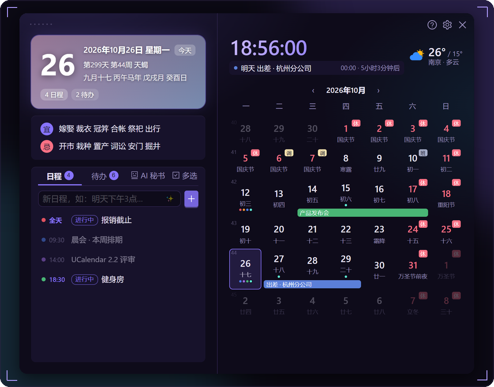
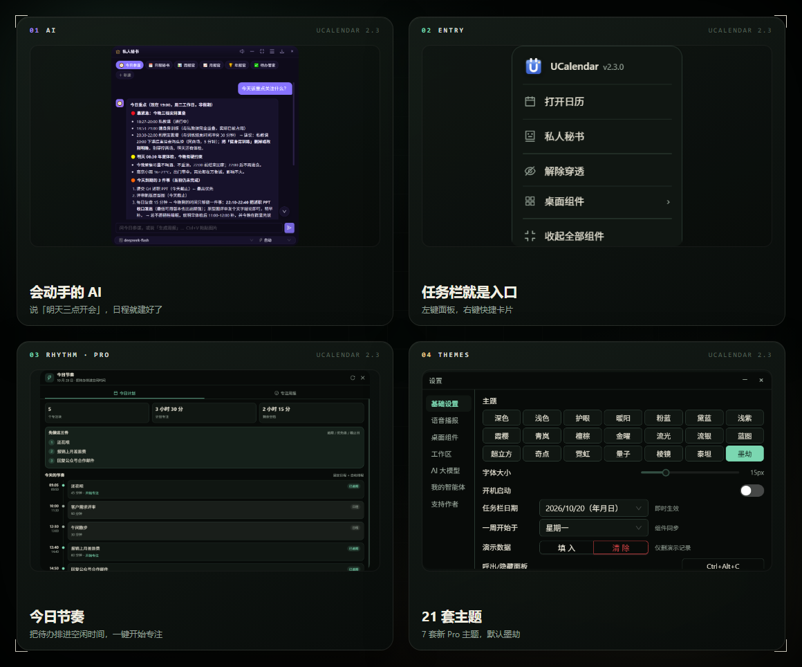
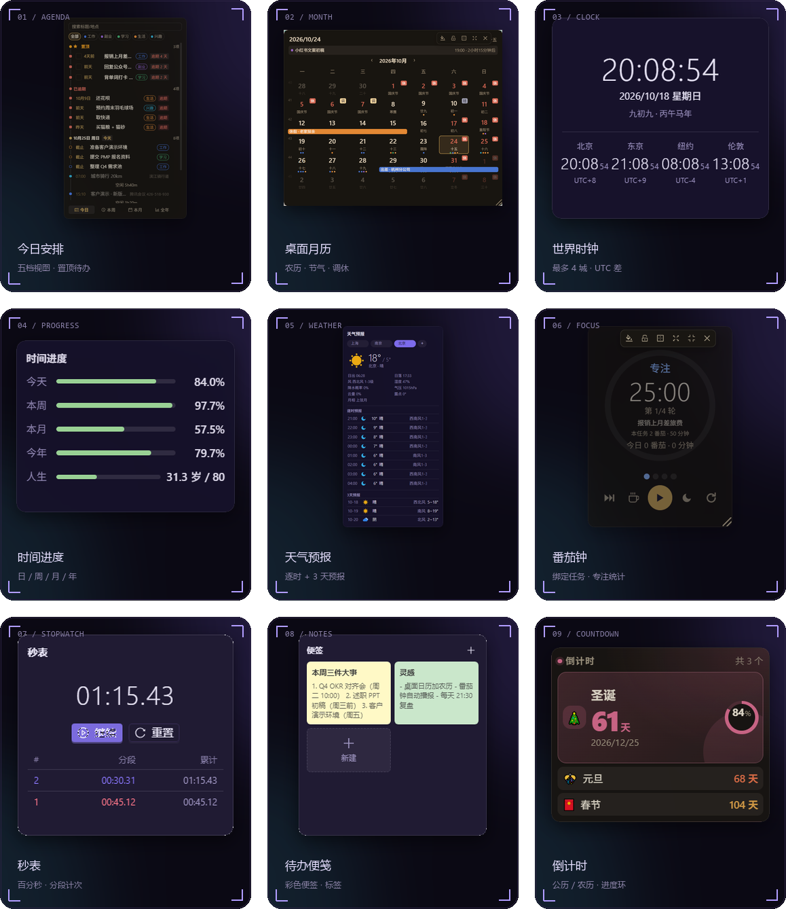

<div align="center">
  
</div>

<br>

<p align="center">
  <a href="https://tobaba.github.io/ucalendar-site/"><b>SITE</b></a>
  &nbsp;·&nbsp;
  <a href="https://github.com/tobaba/UCalendar/releases/latest"><b>DOWNLOAD</b></a>
  &nbsp;·&nbsp;
  <a href="https://github.com/tobaba/UCalendar/releases"><b>RELEASES</b></a>
  &nbsp;·&nbsp;
  <a href="https://github.com/tobaba/UCalendar/issues"><b>ISSUES</b></a>
  &nbsp;·&nbsp;
  <a href="#怎么支持"><b>SUPPORT</b></a>
</p>

## 01 — SHOWCASE

<p align="center">
  
</p>

<p align="center"><sub>左键点任务栏时钟 —— 今天有没有会、这周还剩多少事，一屏说完</sub></p>

## 02 — CAPABILITIES

<p align="center">
  
</p>

## 03 — 9 个桌面组件

<p align="center">
  
</p>

全部组件支持拖动、缩放、透明度、锁定位置、鼠标穿透；单个可收成 40px 摘要条，`Ctrl+Alt+H` 一键专注模式。**开穿透期间组件浮在最上层**，不被资源管理器等窗口盖住。

## 04 — AI 小秘书，真的会动手

```text
你：明天下午三点开会，提前 15 分钟提醒我
AI：已创建「开会」10 月 21 日 15:00（提醒 14:45），要现在写入吗？
你：好
AI：已写入日历
```

- **一句话建日程**：「明天下午三点开会 在会议室 A」「每周一晨会」—— 时间、地点、重复、提醒一次识别
- **会查也会改**：问「这周还有哪些空？」「把周四的健身改到晚上 8 点」，查真实数据再动手
- **日报 / 周报 / 月报 / 年报**：按真实日程与待办生成 Markdown，不用自己回忆
- **6 个预设助手**：今日参谋、日程秘书、待办管家、周报官、月报官、年报官；也能一句话自建助手，或从聊天记录自动提炼
- **多服务商**：DeepSeek、任意 OpenAI 兼容接口、Claude；Key 自己填，只存本机
- **安全边界**：写日程、删数据、执行命令都要弹窗确认；文件操作限定在工作目录
- **自动朗读**：到点按设置语音播报，像个真的秘书

## 05 — DETAILS

<p align="center">
  
</p>

- **提醒 2.0**：日程 / 待办可设多个提前提醒点，同一时刻只提醒一次，Toast 可推迟，旧数据自动兼容
- **置顶待办**：星标最多 3 条，固定在「今日安排」顶部和主面板待办列表，完成 / 删除自动清理
- **待办子任务**：大事拆成小步骤（最多 50 项），列表显示 `2/5`，重复待办下一期自动重置勾选
- **统一回收站**：日程 / 待办 / 便签删除后保留 30 天，可搜索、恢复、彻底删除
- **便签落库**：SQLite 持久化，支持标签、删除进回收站、Markdown 导出，旧 localStorage 自动迁移
- **日历**：农历 / 节气 / 节假日调休 / 黄历宜忌；日程支持自然语言输入、重复规则
- **语音播报**：整点报时、久坐提醒、日程提醒，可换音色与语速，报时文案支持变量
- **主题**：10 套通用（深色 / 浅色 / 护眼 / 暖阳 / 粉蓝 / 浅紫 / 霞樱 / 青岚 / 黛蓝 / 檀棕）+ 支持者专属「金曜」黑金、「流光」极光紫
- **入口**：左键任务栏时钟呼出面板，右键是自绘快捷卡片，托盘图标常驻，`Ctrl+Alt+C` 全局热键，支持开机自启
- **数据**：默认存在 exe 同目录 `data\`，便携模式拷走文件夹 = 带走全部数据

## 06 — DOWNLOAD

**[下载最新版本](https://github.com/tobaba/UCalendar/releases/latest/download/UCalendar.exe)**（约 8.0 MB）

1. 下载 `UCalendar.exe`，双击运行，无需安装
2. 左键点任务栏时钟呼出面板；右键时钟是快捷卡片
3. 首次运行会自动从 `%LOCALAPPDATA%\UCalendar` 迁移旧数据（保留备份）；程序目录不可写时回退到 `%LOCALAPPDATA%`

运行要求：Windows 10 / 11 + WebView2 运行时（Win11 与装过 Edge 的系统已自带）。

## 07 — 怎么支持

日程和待办一直免费，没有广告、不订阅、不联网。20 元起自愿支持，感谢回馈 **UCalendar 完整版**：

- 解锁番茄钟、世界时钟、桌面天气、秒表、时间进度
- 解锁全部主题（含「流光」「金曜」）
- 前 100 位记为**创始支持者**，其余为**同行者**（可匿名）
- 优先答疑，作者亲自回复（附《用户手册》）

操作：面板右下角「怎么支持」→ 扫微信赞赏码并留下邮箱 → 收到支持码后填回同一页面。

<p align="center">
  
</p>

## 08 — SOURCE & FAQ

```powershell
cd UCalendar.Web
npm install
cd ..
.\UCalendar.Web\node_modules\.bin\tauri build --no-bundle   # 产物：src-tauri/target/release/UCalendar.exe
```

技术栈：Tauri 2.12.5 · Rust（rusqlite / rustls / Ed25519）· React 19 + antd · Vite。

**杀毒 / 系统提示未知发布者？** 个人项目未购买代码签名证书，可从 Releases 页面下载并核对文件大小。

**AI 功能必须联网吗？** 需要 API Key 与你选择的服务商；不配置时其余功能照常使用。

**换电脑怎么迁移数据？** 便携模式直接复制整个程序文件夹；数据在 `%LOCALAPPDATA%\UCalendar` 时复制该目录。

**支持哪些系统？** Windows 10 / 11 为官方支持；macOS 源码已支持，暂无官方构建。

---

<p align="center">
  <a href="https://github.com/tobaba/UCalendar/issues">Issues</a>
  &nbsp;·&nbsp;
  <a href="https://github.com/tobaba/UCalendar/releases">Releases</a>
  &nbsp;·&nbsp;
  <a href="mailto:tobestway@foxmail.com">tobestway@foxmail.com</a>
</p>

<p align="center"><sub>如果它每天帮你省下那几次切窗口 —— Star 就是最实在的支持</sub></p>
