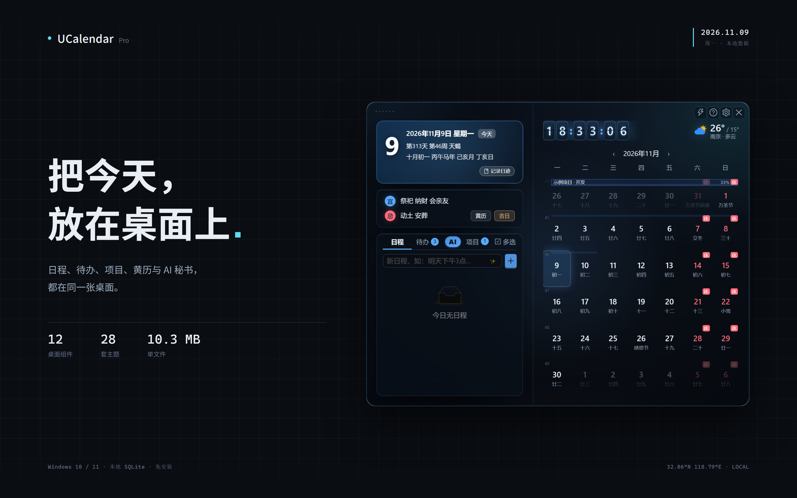
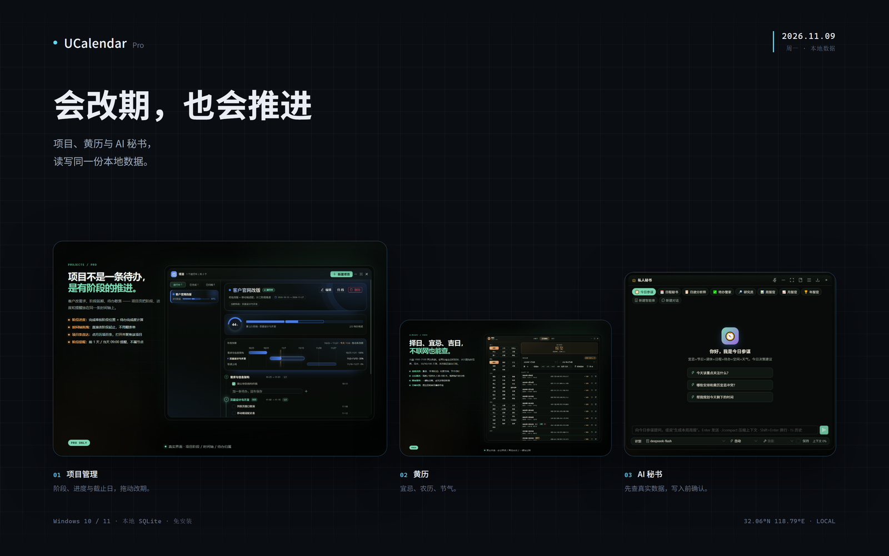
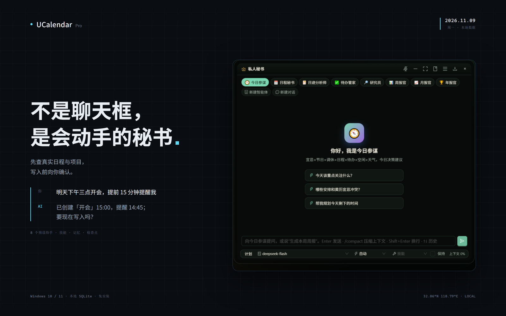

<p align="center">
  <a href="https://tobaba.github.io/ucalendar-site/">SITE</a>
  &nbsp;·&nbsp;
  <a href="https://github.com/tobaba/UCalendar/releases/latest">DOWNLOAD</a>
  &nbsp;·&nbsp;
  <a href="https://github.com/tobaba/UCalendar/releases">RELEASES</a>
  &nbsp;·&nbsp;
  <a href="https://github.com/tobaba/UCalendar/issues">ISSUES</a>
  &nbsp;·&nbsp;
  <a href="#怎么支持">SUPPORT</a>
</p>

**Windows 桌面日历 + AI 私人秘书。** 日程、待办、项目、黄历、桌面组件和 AI 都在同一张桌面；本地 SQLite，不登录，单文件约 10.3 MB。

<p align="center">
  
</p>

## 一眼看懂

<p align="center">
  
</p>

- **任务栏时钟即入口**：左键呼出面板，右键是快捷菜单；`Ctrl+Alt+C` 全局热键，托盘常驻
- **12 个桌面组件**：月历、今日安排、天气、番茄钟、倒计时、便签、世界时钟、秒表、时间进度、项目进度、股票、音乐
- **会动手的 AI**：一句话建日程、查空、改期、写周报；先查真实数据，写入前确认
- **项目不是一条待办**：阶段、进度、时间轴拖拽改期，月历项目条直达
- **黄历 / 吉日**：1900–2100 离线宜忌、时辰吉凶、吉日筛选，找到日子直接加日程
- **本地优先**：数据默认在 `%LOCALAPPDATA%\UCalendar`；exe 同目录有 `data\` 时自动用便携目录

## 12 个桌面组件，读同一份数据

<p align="center">
  
</p>

**不是静态展示卡。** 主面板改完，桌面上的组件立刻同步。

- **Lite 免费 6 个**：桌面月历、今日安排、天气、番茄钟、倒计时、便签
- **Pro 再加 6 个**：世界时钟、秒表、时间进度、项目进度、股票行情、音乐播放
- **桌面月历三视图**：完整月历 / 周视图 / 焦点视图；宽窗时间网格，窄窗自动收成周议程
- **外观与位置**：拖动、缩放、透明度、锁定、鼠标穿透；Pro 支持磨砂、字体、字号、前景色，一次应用到全部
- **收起胶囊栏**：组件收起后汇总到全局胶囊栏，点击或悬停展开，支持拖动排序和全部展开
- **股票**：自选最多 20 只，实时行情 + K 线，多源自动回退，支持红涨绿跌 / 绿涨红跌
- **音乐**：接管 Windows 系统媒体会话，封面 / 歌名 / 进度 / 播放控制，不用登录

## 28 套主题，换一种桌面气质

<p align="center">
  
</p>

从深色、浅色、护眼、暖阳到智核、蒙德里安、勃艮第，编号 01–28，设置里一屏看全。面板、设置、弹窗和桌面组件同步换肤；支持切换字体与字号。

- **6 套免费**：深色、浅色、护眼、暖阳、粉蓝、黛蓝
- **22 套 Pro**：含「智核」AI 科技风，主面板顶部为翻页时钟
- **默认主题**：Pro 首启「墨劫」，未解锁高级主题时回退「粉蓝」；Lite 首启「深色」

## AI 小秘书，真的会动手

<p align="center">
  
</p>

```text
你：明天下午三点开会，提前 15 分钟提醒我
AI：已创建「开会」15:00（提醒 14:45），要现在写入吗？
你：好
AI：已写入日历
```

- **一句话建日程**：「明天下午三点开会 在会议室 A」「每周一晨会」——时间、地点、重复、提醒一次识别
- **会查也会改**：问「这周还有哪些空？」「把周四的健身改到晚上 8 点」，查真实数据再动手
- **日报 / 周报 / 月报 / 年报**：按真实日程与待办生成 Markdown
- **8 个预设助手**：今日参谋、日程秘书、日迹分析师、待办管家、研究员、周报官、月报官、年报官
- **多服务商**：DeepSeek、任意 OpenAI 兼容接口、Claude；Key 自己填，只存本机
- **技能调用**：工作区 `skills/` 放技能说明，输入 `/` 直接选择并注入
- **安全边界**：写日程、删数据、执行命令都要确认；文件操作限定在工作目录

### 微信机器人（Pro）

UCalendar 运行时扫码绑定微信，私聊即可查询和修改日程、待办、便签，发图片还能交给 AI 识别。陌生微信先发 `/pair 配对码` 才能用；token 只存本机，关闭 UCalendar 即停止服务。

常用指令：`/today` `/weather` `/almanac` `/news` `/new` `/stop` `/support`

## 项目管理（Pro）

**项目不是一条待办，是一段有阶段的推进。** 客户改需求、阶段延期、待办散落——项目页把阶段、进度和提醒放在同一条时间轴上。

- **阶段进度**：完成率 = 阶段位置 + 当前阶段待办完成度；没有待办时也不会算假进度
- **时间轴拖拽**：直接拖动阶段起止改期，不用翻表单
- **项目条直达**：月历上的项目条显示当前阶段和进度，点一下打开并聚焦该项目
- **阶段提醒**：前 1 天 / 当天 09:00 提醒，节点不漏
- **归属清晰**：日程按时间轴独立安排；待办能挂到项目和阶段

## 黄历 / 吉日（免费）

**择日不靠翻网页，宜忌不靠猜。** 内置 1900–2100 黄历数据，独立窗查老黄历和吉日；找到日子直接落到日程或项目阶段。

- **离线黄历**：宜忌、18 格信息、时辰吉凶、下个吉时、未来 7 天
- **吉日筛选**：范围 / 仅周末 / 30–180 天，结果按月份分组
- **直接落地**：一键加日程，或写进项目阶段
- **分享长图**：把宜忌和吉日清单带走
- **两个版本都能用**：Lite 也包含黄历 / 吉日，不联网也能查

## 下载

**Pro v2.8.6**（约 9.8 MB，免费下载，先体验后支持）：[下载 UCalendar.exe](https://github.com/tobaba/UCalendar/releases/latest/download/UCalendar.exe)

**Lite v2.8.6**（约 8.4 MB，永久免费）：[下载 UCalendar-Lite.exe](https://github.com/tobaba/ucalendar-lite/releases/latest/download/UCalendar-Lite.exe)

<p align="center">
  
</p>

1. 下载 exe，双击运行，无需安装
2. 左键点任务栏时钟呼出面板；右键时钟是快捷菜单
3. 数据默认在 `%LOCALAPPDATA%\UCalendar`；程序目录不可写时自动回退

运行要求：Windows 10 / 11 + WebView2 运行时（Win11 与装过 Edge 的系统通常已自带；缺失时首次启动会联网安装）。

**Lite 与 Pro 的边界**：Lite 保留日程、待办、月历、今日安排、黄历吉日、便签、6 个桌面组件、6 套主题与 AI；项目管理、便签管理、日迹、时间册导出、今日节奏、微信机器人、6 个 Pro 专属组件、工作区预设和 22 套高级主题属于 Pro。两个版本数据互通。

## 常见问题

<details>
<summary>杀毒 / 系统提示未知发布者？</summary>
Pro 与 Lite 单文件均使用 `CN=UCalendar Studio` 代码签名；SmartScreen 首次运行仍可能提示，可从 Releases 下载并核对文件大小。
</details>

<details>
<summary>AI 功能必须联网吗？</summary>
需要 API Key 与你选择的服务商；不配置时其余功能照常使用。
</details>

<details>
<summary>换电脑怎么迁移数据？</summary>
便携模式直接复制整个程序文件夹；数据在 `%LOCALAPPDATA%\UCalendar` 时复制该目录。
</details>

<details>
<summary>支持哪些系统？</summary>
Windows 10 / 11 为官方支持；macOS 源码已支持，暂无官方构建。
</details>

## SOURCE

```powershell
cd UCalendar.Web
npm install
cd ..
.\UCalendar.Web\node_modules\.bin\tauri build --no-bundle
# 产物：src-tauri/target/release/UCalendar.exe
```

技术栈：Tauri 2.12.5 · Rust（rusqlite / rustls / Ed25519）· React 19 + antd · Vite。

## 怎么支持

日程和待办一直免费，没有广告、不订阅、不强制登录。20 元起自愿支持，感谢回馈 **UCalendar Pro**：

- 解锁项目管理、便签管理页、今日节奏、日迹 / 时间册导出
- 解锁世界时钟、秒表、时间进度、项目进度、股票行情、音乐播放
- 解锁 22 套高级主题与工作区预设
- 前 100 位记为**创始支持者**，其余为**同行者**（可匿名）
- 优先答疑，作者亲自回复

<p align="center">
  
</p>

操作：面板右下角「怎么支持」→ 扫微信赞赏码并留下邮箱 → 收到支持码后填回同一页面。

---

<p align="center">
  <a href="https://github.com/tobaba/UCalendar/issues">Issues</a>
  &nbsp;·&nbsp;
  <a href="https://github.com/tobaba/UCalendar/releases">Releases</a>
  &nbsp;·&nbsp;
  <a href="https://tobaba.github.io/ucalendar-site/">Website</a>
  &nbsp;·&nbsp;
  <a href="mailto:tobestway@foxmail.com">tobestway@foxmail.com</a>
</p>

<p align="center"><sub>如果它每天帮你省下那几次切窗口 —— Star 就是最实在的支持</sub></p>
