<div align="center">
  
</div>

<br>

<p align="center">
  <a href="https://tobaba.github.io/ucalendar-site/"><b>SITE</b></a>
  &nbsp;·&nbsp;
  <a href="https://github.com/tobaba/UCalendar/releases/latest"><b>DOWNLOAD</b></a>
  &nbsp;·&nbsp;
  <a href="https://github.com/tobaba/UCalendar/releases"><b>RELEASES</b></a>
  &nbsp;·&nbsp;
  <a href="https://github.com/tobaba/UCalendar/issues"><b>ISSUES</b></a>
  &nbsp;·&nbsp;
  <a href="#怎么支持"><b>SUPPORT</b></a>
</p>

## 01 — SHOWCASE

<p align="center">
  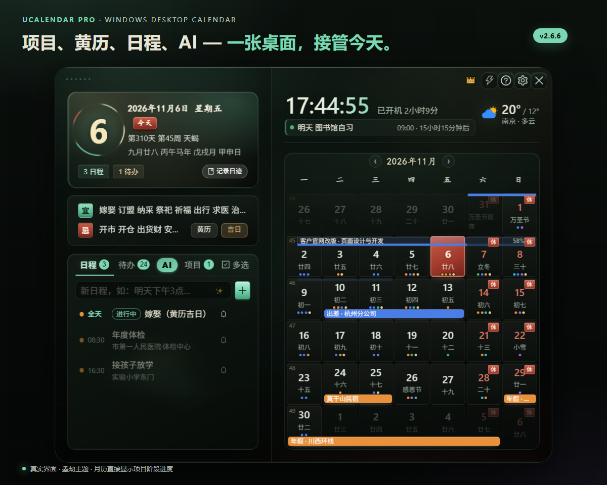
</p>

<p align="center"><sub>默认墨劫主题 —— 左键点任务栏时钟，今天有没有会、这周还剩多少事、项目推进到哪，一屏说完</sub></p>

## 02 — CAPABILITIES

<p align="center">
  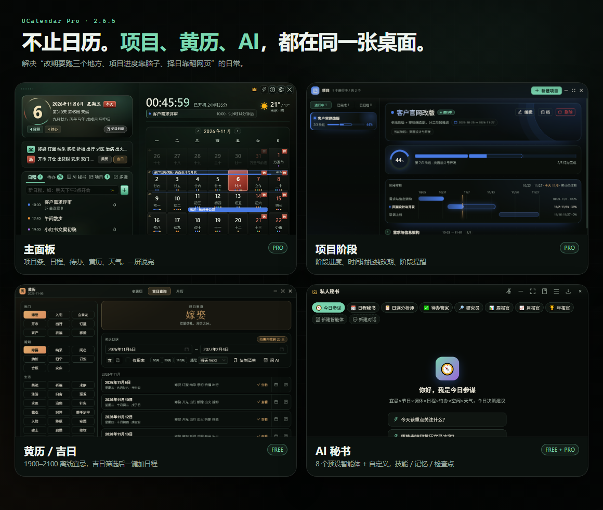
</p>

## 03 — 项目管理（Pro）

<p align="center">
  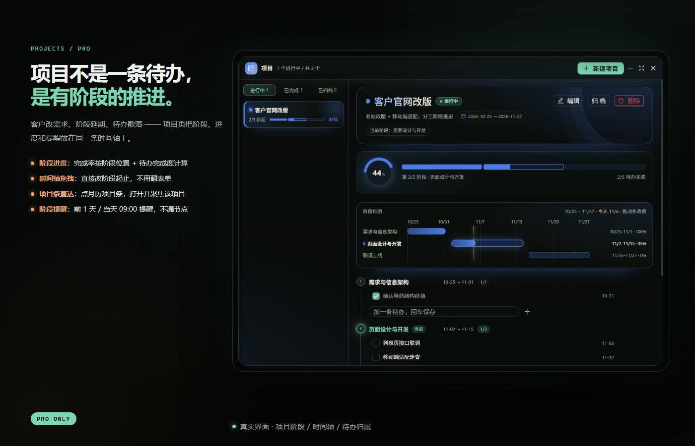
</p>

**项目不是一条待办，是一段有阶段的推进。** 客户改需求、阶段延期、待办散落——项目页把阶段、进度和提醒放在同一条时间轴上。

- **阶段进度**：完成率 = 阶段位置 + 当前阶段待办完成度；没有待办时也不会算假进度
- **时间轴拖拽**：直接拖动阶段起止改期，不用翻表单
- **项目条直达**：月历上的项目条显示当前阶段和进度，点一下打开并聚焦该项目
- **阶段提醒**：前 1 天 / 当天 09:00 提醒，节点不漏
- **归属清晰**：日程、待办都能挂到项目和阶段，项目页直接看到阶段内待办

## 04 — 黄历 / 吉日（免费）

<p align="center">
  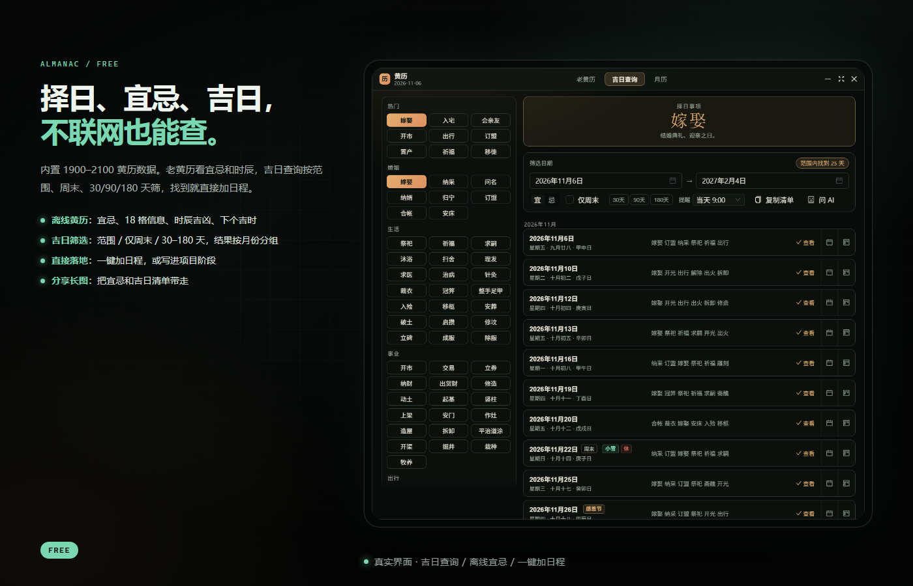
</p>

**择日不靠翻网页，宜忌不靠猜。** 内置 1900–2100 黄历数据，独立窗查老黄历和吉日；找到日子直接落到日程或项目阶段。

- **离线黄历**：宜忌、18 格信息、时辰吉凶、下个吉时、未来 7 天
- **吉日筛选**：范围 / 仅周末 / 30–180 天，结果按月份分组
- **直接落地**：一键加日程，或写进项目阶段
- **分享长图**：把宜忌和吉日清单带走
- **两个版本都能用**：Lite 也包含黄历 / 吉日，不联网也能查

## 05 — 9 个桌面组件

<p align="center">
  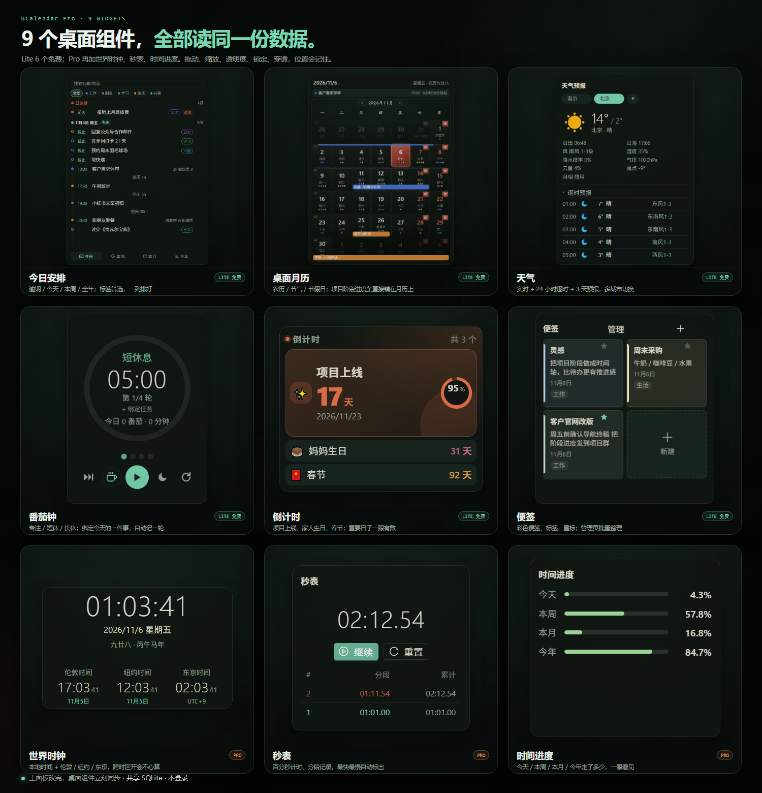
</p>

### 完整月历

<p align="center">
  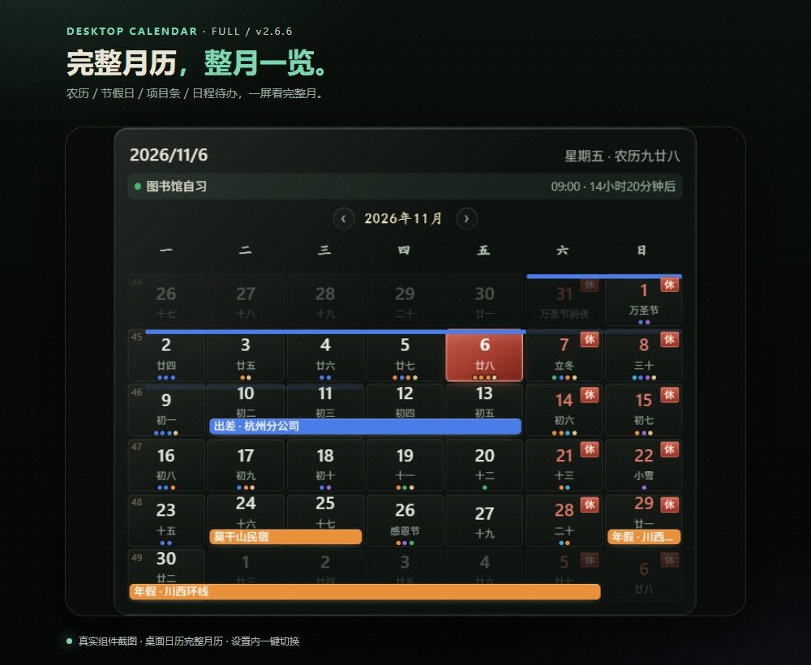
</p>

### 周视图

<p align="center">
  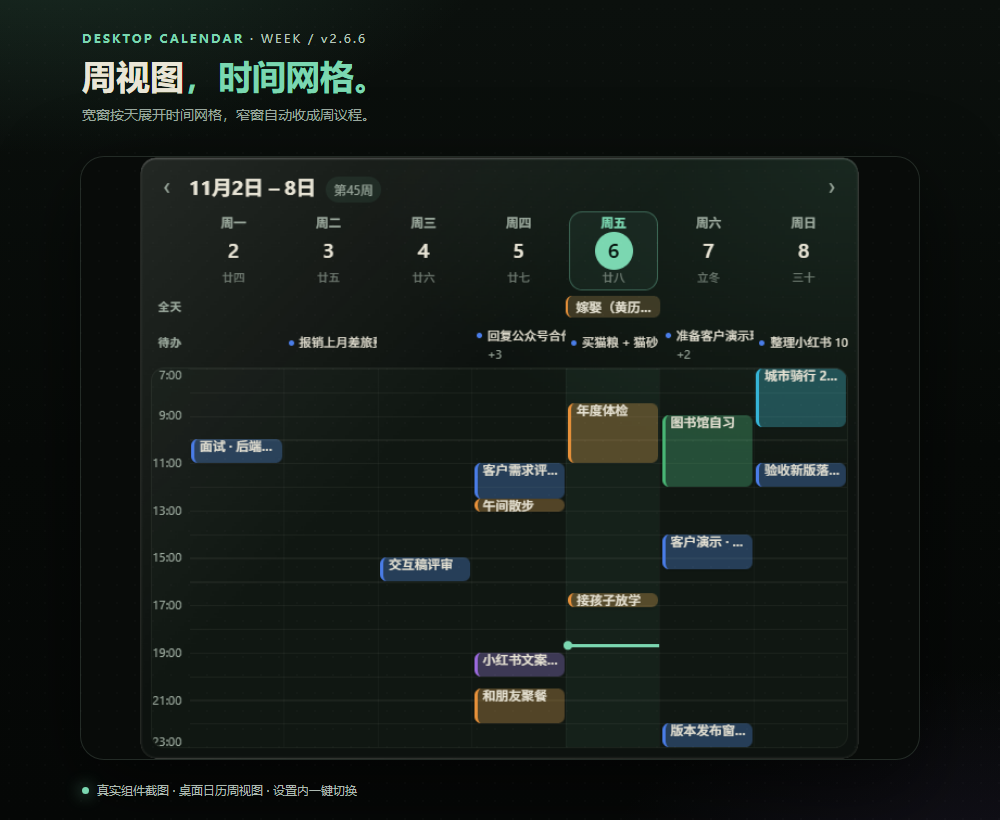
</p>

### 焦点视图

<p align="center">
  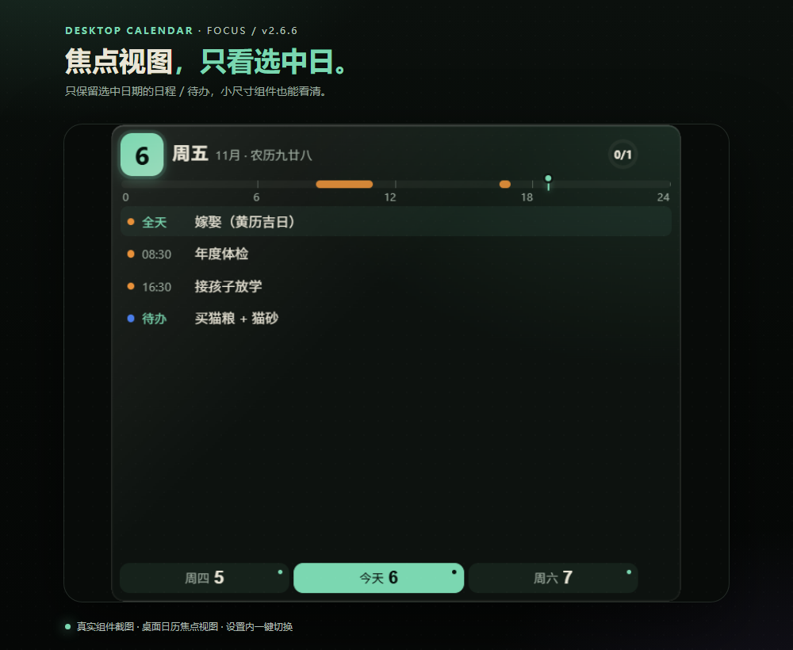
</p>

<p align="center">
  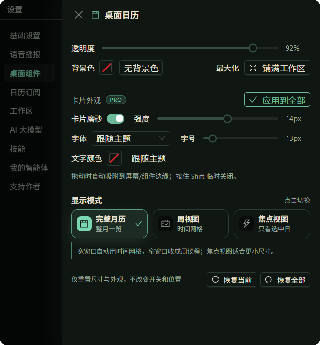
</p>

<p align="center"><sub>组件设置：显示模式、拖动吸附、Pro 磨砂 / 字体 / 文字颜色，以及应用到全部 / 恢复当前 / 恢复全部。</sub></p>

全部组件支持拖动、缩放、透明度、锁定位置、鼠标穿透；单个可收成 40px 摘要条，`Ctrl+Alt+H` 一键专注模式。**开穿透期间组件浮在最上层**，不被资源管理器等窗口盖住。

- **拖动吸附**：拖动时实时吸附屏幕 / 组件边缘与中线，松手保持；按住 `Shift` 临时关闭
- **组件外观**：Pro 支持磨砂玻璃、字体 / 字号 / 前景色；可「应用到全部」或「恢复当前 / 恢复全部」（只重置尺寸与外观）
- **桌面日历视图**：完整月历 / 周视图 / 焦点视图，宽窗时间网格、窄窗自动周议程

## 06 — 21 套主题，换一种桌面气质

<p align="center">
  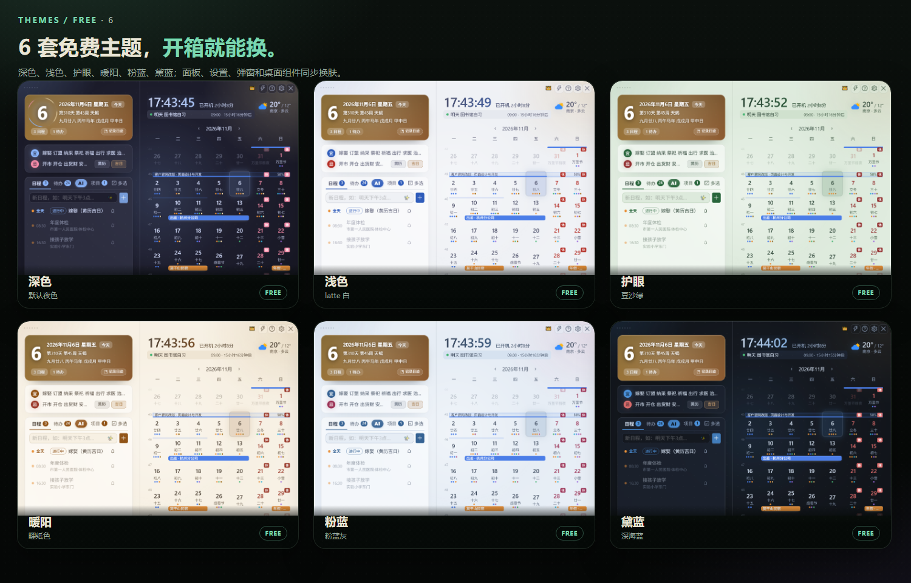
</p>

<p align="center">
  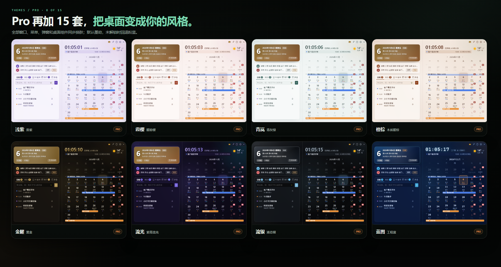
</p>

<p align="center">
  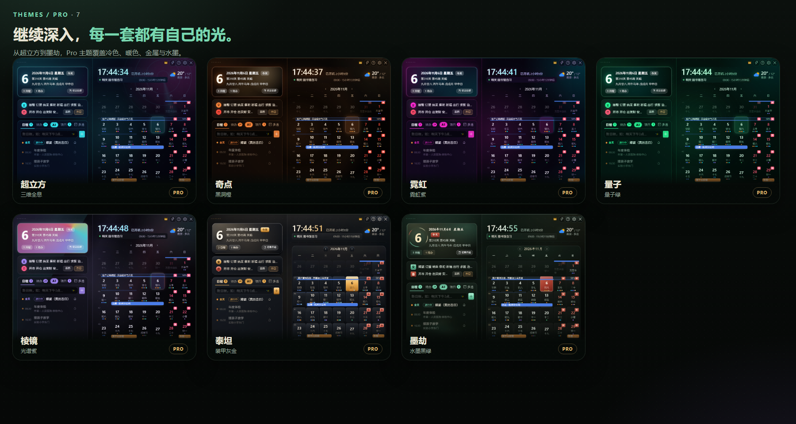
</p>

<p align="center"><sub>全部 21 套：6 套免费 + 15 套 Pro；面板、设置、弹窗和桌面组件同步换肤。</sub></p>

## 07 — AI 小秘书，真的会动手

```text
你：明天下午三点开会，提前 15 分钟提醒我
AI：已创建「开会」10 月 21 日 15:00（提醒 14:45），要现在写入吗？
你：好
AI：已写入日历
```

<p align="center">
  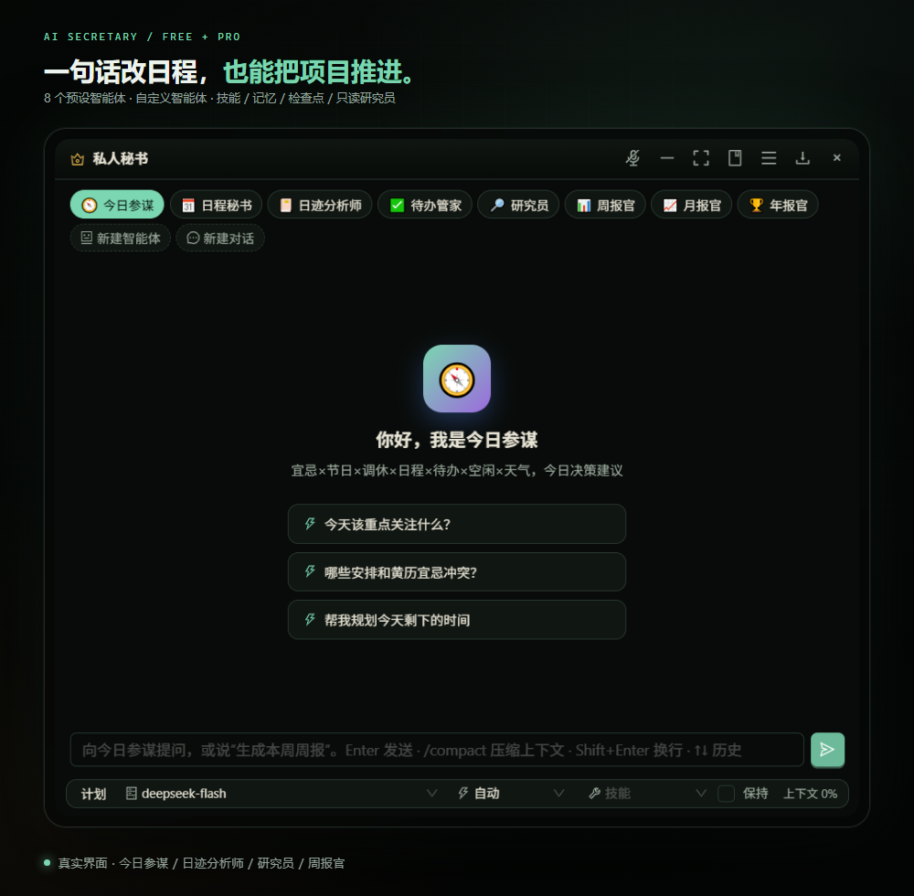
</p>

- **一句话建日程**：「明天下午三点开会 在会议室 A」「每周一晨会」—— 时间、地点、重复、提醒一次识别
- **会查也会改**：问「这周还有哪些空？」「把周四的健身改到晚上 8 点」，查真实数据再动手
- **日报 / 周报 / 月报 / 年报**：按真实日程与待办生成 Markdown，不用自己回忆
- **8 个预设助手**：今日参谋、日程秘书、日迹分析师、待办管家、研究员、周报官、月报官、年报官；也能一句话自建助手，或从聊天记录自动提炼
- **多服务商**：DeepSeek、任意 OpenAI 兼容接口、Claude；Key 自己填，只存本机
- **技能调用**：工作区 `skills/` 放技能说明，输入 `/` 直接选择并注入；`Ctrl+Alt+A` 可随时打开私人秘书
- **安全边界**：写日程、删数据、执行命令都要弹窗确认；文件操作限定在工作目录
- **自动朗读**：到点按设置语音播报，像个真的秘书

## 08 — DETAILS

<p align="center">
  
</p>

- **提醒 2.0**：日程 / 待办可设多个提前提醒点，同一时刻只提醒一次，Toast 可推迟，旧数据自动兼容
- **置顶待办**：星标最多 3 条，固定在「今日安排」顶部和主面板待办列表，完成 / 删除自动清理
- **待办子任务**：大事拆成小步骤（最多 50 项），列表显示 `2/5`，重复待办下一期自动重置勾选
- **统一回收站**：日程 / 待办 / 便签删除后保留 30 天，可搜索、恢复、彻底删除
- **便签落库**：SQLite 持久化，支持标签、删除进回收站、Markdown 导出，旧 localStorage 自动迁移
- **项目阶段**：项目和阶段、日程 / 待办归属；月历项目条、项目页时间轴、阶段到期提醒，点项目条直达项目窗口
- **日历**：农历 / 节气 / 节假日调休 / 黄历宜忌；日程支持自然语言输入、重复规则
- **日历视图**：桌面日历可切完整月历 / 周视图 / 焦点视图；周视图宽窗时间网格、窄窗自动收成周议程，设置内可“应用到全部 / 恢复全部”组件外观
- **黄历 / 吉日**：独立窗查 1900–2100 宜忌与释义，离线可用；吉日可直接加日程或写项目阶段
- **语音播报**：整点报时、久坐提醒、日程提醒，可换音色与语速，报时文案支持变量
- **主题**：21 套（深色 / 浅色 / 护眼 / 暖阳 / 粉蓝 / 浅紫 / 霞樱 / 青岚 / 黛蓝 / 檀棕 + 支持者专属「金曜」「流光」「流银」「蓝图」「超立方」「奇点」「霓虹」「量子」「棱镜」「泰坦」「墨劫」）
- **默认主题**：Pro 首启「墨劫」（未解锁高级主题时回退「粉蓝」），Lite 首启「深色」；已经选过主题的用户保持自己的选择
- **面板入口**：日程 / 待办 / AI / 项目 / 多选一屏可达；AI 用紧凑胶囊按钮，随主题换色，不挤占工具行
- **入口**：左键任务栏时钟呼出面板，右键是自绘快捷卡片，托盘图标常驻，`Ctrl+Alt+C` 全局热键，支持开机自启
- **数据**：默认在 `%LOCALAPPDATA%\UCalendar`；exe 同目录有 `data\` 时使用便携目录，拷走文件夹 = 带走全部数据

## 09 — DOWNLOAD

**[下载最新版本](https://github.com/tobaba/UCalendar/releases/latest/download/UCalendar.exe)**（约 9.1 MB）

1. 下载 `UCalendar.exe`，双击运行，无需安装
2. 左键点任务栏时钟呼出面板；右键时钟是快捷卡片
3. 首次运行会自动从 `%LOCALAPPDATA%\UCalendar` 迁移旧数据（保留备份）；程序目录不可写时回退到 `%LOCALAPPDATA%`

运行要求：Windows 10 / 11 + WebView2 运行时（Win11 与装过 Edge 的系统已自带；缺失时首次启动会自动联网安装）。

**Lite 版（免费，当前 v2.6.6）**：6 个桌面组件、6 套主题，保留日程 / 待办 / 月历 / 黄历吉日 / 便签与 AI；项目管理、便签管理、日迹 / 时间册导出 / 今日节奏属于 Pro。设置 → 关于可查看版本、GitHub 反馈和 Pro 升级入口。

[下载 UCalendar Lite](https://github.com/tobaba/ucalendar-lite/releases/latest/download/UCalendar-Lite.exe)

## 10 — 怎么支持

日程和待办一直免费，没有广告、不订阅、不联网。20 元起自愿支持，感谢回馈 **UCalendar Pro**：

- 解锁「项目管理」：项目阶段、月历项目条、时间轴、阶段到期提醒
- 解锁「便签管理页」：搜索、标签、星标、批量整理
- 解锁「今日节奏」：本地确定性日计划 + 专注完成提示 + 近 7 天专注周报
- 解锁世界时钟、秒表、时间进度与「工作区预设」
- 解锁 15 套高级主题（含「金曜」「流光」「流银」「蓝图」「超立方」「奇点」「霓虹」「量子」「棱镜」「泰坦」「墨劫」）
- 前 100 位记为**创始支持者**，其余为**同行者**（可匿名）
- 优先答疑，作者亲自回复（附《用户手册》）

操作：面板右下角「怎么支持」→ 扫微信赞赏码并留下邮箱 → 收到支持码后填回同一页面。

<p align="center">
  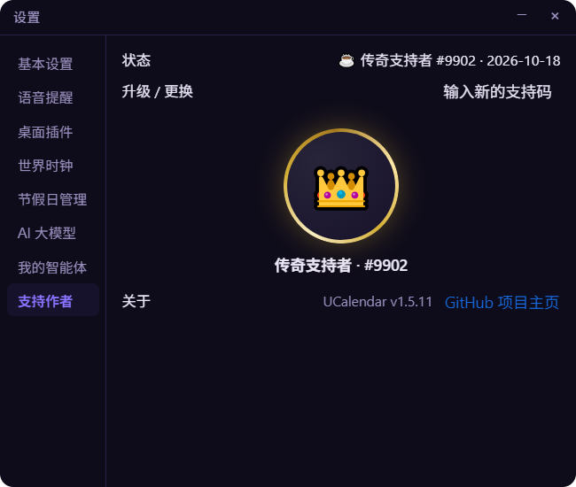
</p>

## 11 — SOURCE & FAQ

```powershell
cd UCalendar.Web
npm install
cd ..
.\UCalendar.Web\node_modules\.bin\tauri build --no-bundle   # 产物：src-tauri/target/release/UCalendar.exe
```

技术栈：Tauri 2.12.5 · Rust（rusqlite / rustls / Ed25519）· React 19 + antd · Vite。

**杀毒 / 系统提示未知发布者？** Pro 与 Lite 单文件均使用 `CN=UCalendar Studio` 代码签名；SmartScreen 首次运行仍可能提示未知发布者。可从 Releases 页面下载并核对文件大小。

**AI 功能必须联网吗？** 需要 API Key 与你选择的服务商；不配置时其余功能照常使用。

**换电脑怎么迁移数据？** 便携模式直接复制整个程序文件夹；数据在 `%LOCALAPPDATA%\UCalendar` 时复制该目录。

**支持哪些系统？** Windows 10 / 11 为官方支持；macOS 源码已支持，暂无官方构建。

---

<p align="center">
  <a href="https://github.com/tobaba/UCalendar/issues">Issues</a>
  &nbsp;·&nbsp;
  <a href="https://github.com/tobaba/UCalendar/releases">Releases</a>
  &nbsp;·&nbsp;
  <a href="mailto:tobestway@foxmail.com">tobestway@foxmail.com</a>
</p>

<p align="center"><sub>如果它每天帮你省下那几次切窗口 —— Star 就是最实在的支持</sub></p>
